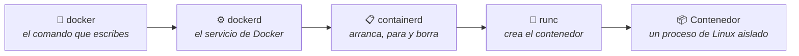
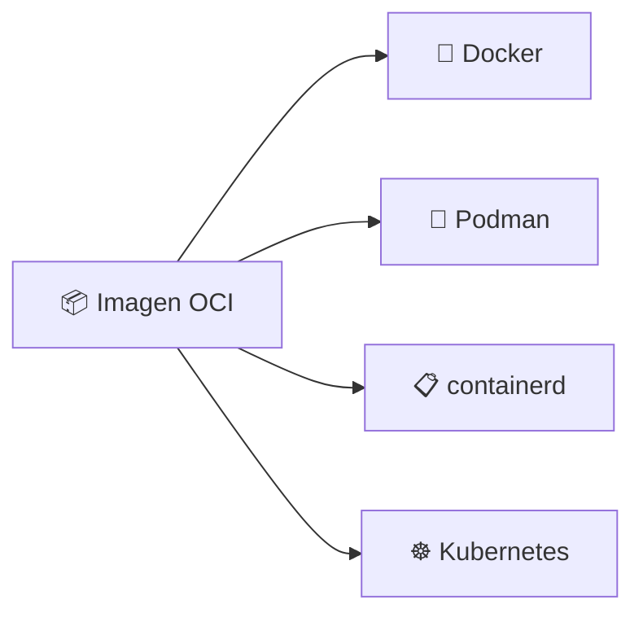
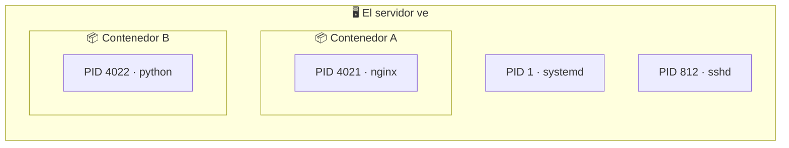
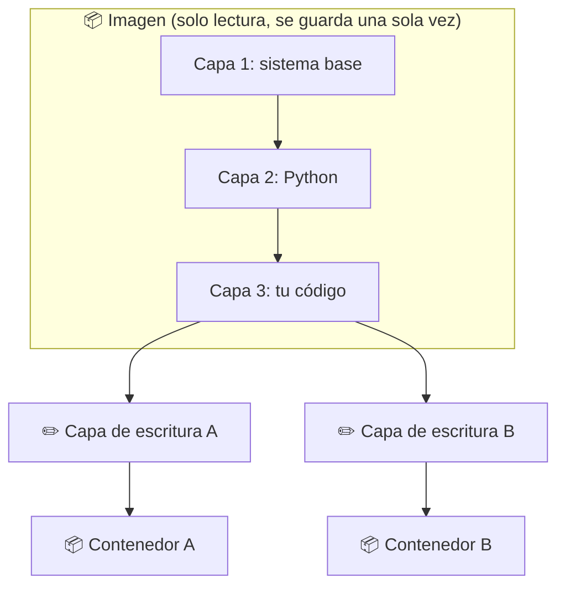
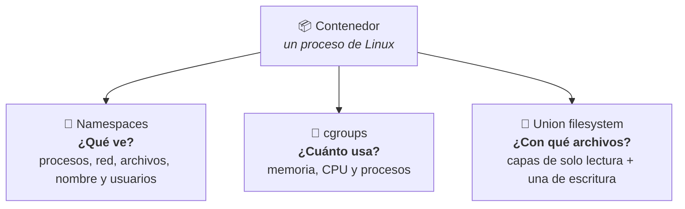

# 🐳 Docker · D02: Cómo funciona por dentro

> 📅 Viernes 16 de octubre de 2026 · ⏱️ 45 min

**🎯 Objetivo:** saber qué piezas hay detrás de `docker run` y qué tres funciones de Linux hacen posible un contenedor. Solo hace falta la idea general, no hay que memorizar comandos.

| ⏱️ Tiempo | 📚 Bloque |
| :---: | :--- |
| 12 min | 🐳 Docker y el estándar OCI |
| 9 min | 🧱 Namespaces |
| 8 min | 📏 cgroups |
| 8 min | 🍰 Union filesystems (capas) |
| 8 min | ✍️ Práctica |

---

## 🐳 1. Docker y el estándar OCI `12 min`

Cuando escribes un comando de Docker, no lo hace todo un solo programa. Varias piezas se pasan el trabajo, y la última es la que de verdad crea el contenedor.



| Pieza | Qué hace |
| :--- | :--- |
| 👤 `docker` | El comando que escribes tú. |
| ⚙️ `dockerd` | El servicio de Docker. Recibe tus órdenes y gestiona imágenes, redes y volúmenes. |
| 📋 `containerd` | Gestiona el ciclo de vida de los contenedores: arrancar, parar y borrar. |
| 🔧 `runc` | Crea el contenedor usando las funciones de Linux. |

### 📜 Qué es OCI

**OCI (Open Container Initiative)** es un grupo que Docker y otras empresas fundaron en 2015. Escribe las reglas comunes para que una imagen hecha con una herramienta funcione en cualquier otra.

> 🔌 **Piénsalo como el USB:** da igual la marca del cable, el enchufe es el mismo.

| 📄 Especificación | ❓ Qué define |
| :--- | :--- |
| **Image spec** | Cómo es una imagen: el formato de las capas y la configuración. |
| **Runtime spec** | Cómo se ejecuta: qué debe hacer un programa para arrancar un contenedor. |
| **Distribution spec** | Cómo se comparte: cómo se suben y bajan imágenes de un registro como Docker Hub. |



---

## 🧱 2. Namespaces: lo que ve el contenedor `9 min`

Un namespace es una **pared de cristal**. El proceso de dentro solo ve lo que hay en su espacio, y cree que está solo en el ordenador.



Lo que ve el contenedor A desde dentro:

```text
┌──────────────────────────┐
│ 📦 Contenedor A          │
│                          │
│   PID 1 · nginx          │
│                          │
│ (no ve sshd ni al B)     │
└──────────────────────────┘
```

Para él, nginx es el primer proceso del ordenador.

| 🧱 Namespace | 🔒 Qué aísla | 💬 Qué significa para el contenedor |
| :---: | :--- | :--- |
| **PID** | Los procesos | Solo ve sus propios procesos. |
| **NET** | La red | Tiene sus propias interfaces, direcciones IP y puertos. |
| **MNT** | Los archivos | Ve su propio sistema de archivos, no el del servidor. |
| **UTS** | El nombre del equipo | Tiene su propio hostname. |
| **IPC** | La comunicación entre procesos | No comparte memoria con otros contenedores. |
| **USER** | Los usuarios | Puede ser «root» dentro sin serlo fuera. |

---

## 📏 3. cgroups: lo que puede usar el contenedor `8 min`

Los namespaces dicen **lo que el contenedor ve**. Los cgroups (control groups) dicen **cuánto puede gastar**. Sin ellos, un contenedor podría quedarse con toda la memoria o todo el procesador del servidor.

```text
🧠 Memoria     [█░░░░░░░░░░░░░░░]  límite 256 MB   (servidor: 16 GB)
⚡ CPU         [█░░░░░░░░░░░░░░░]  límite 0,5 CPU  (servidor: 4 CPU)
🔢 Procesos    [██████░░░░░░░░░░]  límite 100      (a la vez)
```

| Recurso | 🚦 Límite de ejemplo | Para qué sirve |
| :--- | :---: | :--- |
| 🧠 Memoria | 256 MB | El contenedor no puede pasar de ese tope. |
| ⚡ Procesador (CPU) | 0,5 CPU | Puede usar como mucho medio núcleo. |
| 🔢 Procesos | 100 | Evita que un fallo llene el servidor de procesos. |

> [!WARNING]
> Si un contenedor intenta usar más memoria que su límite, **Linux lo para**. Con la CPU no se para: solo va más lento.

> [!NOTE]
> Los límites son opcionales. Si no pones ninguno, el contenedor puede usar todo lo que tenga el servidor.

---

## 🍰 4. Union filesystems: los archivos en capas `8 min`

Una imagen no es un solo bloque. Son **capas de solo lectura** puestas una encima de otra, y un sistema de archivos «union» las muestra juntas como si fueran una sola carpeta. Docker lo hace con un driver llamado `overlay2`.

```text
   📦 Contenedor A                📦 Contenedor B
┌─────────────────────┐        ┌─────────────────────┐
│ ✏️ Capa de escritura A│        │ ✏️ Capa de escritura B│   ← propia, se puede escribir
├─────────────────────┤        ├─────────────────────┤
│ 🔒 Capa 3: tu código  │   =    │ 🔒 Capa 3: tu código  │
│ 🔒 Capa 2: Python     │   =    │ 🔒 Capa 2: Python     │   ← compartidas, solo lectura
│ 🔒 Capa 1: sistema    │   =    │ 🔒 Capa 1: sistema    │
└─────────────────────┘        └─────────────────────┘
        └──────────── la misma imagen ────────────┘
```



| 💡 Idea | 📝 Qué significa |
| :--- | :--- |
| 🤝 **Se comparten** | Si lanzas 10 contenedores de la misma imagen, las capas de la imagen se guardan una sola vez. Solo cada capa de escritura es nueva. |
| 📑 **Copy-on-write** | Si un contenedor cambia un archivo de una capa de abajo, Docker copia ese archivo a la capa de escritura y cambia la copia. La imagen original no se toca. |
| 🗑️ **Efímera** | Al borrar el contenedor se borra su capa de escritura. Por eso los datos importantes necesitan volúmenes, que veremos en D06. |

---

## 🧩 5. Las tres piezas juntas

Un contenedor es **un proceso normal de Linux con tres ayudas**. Ninguna pieza es nueva: Docker las junta de forma fácil.



| ❓ Pregunta | 🔧 Tecnología | 📝 En una frase |
| :--- | :---: | :--- |
| ¿Qué ve? | 🧱 Namespaces | Aíslan la vista del contenedor. |
| ¿Cuánto usa? | 📏 cgroups | Limitan los recursos. |
| ¿Con qué archivos? | 🍰 Union filesystem | Apila capas y añade una de escritura. |

### ⭐ Ideas clave

1. 🐳 Docker es una cadena de piezas: `docker`, `dockerd`, `containerd` y `runc`.
2. 📜 OCI define el formato de las imágenes y cómo se ejecutan y se comparten, para que las herramientas sean intercambiables.
3. 🐧 Namespaces, cgroups y capas son funciones del núcleo de Linux.
4. 💻 En Mac y Windows, Docker Desktop ejecuta una máquina virtual con Linux por debajo, porque esas funciones solo existen en Linux.

---

## ✍️ 6. Práctica: explícalo con tus palabras `8 min`

Escribe una o dos frases para cada tecnología, como si se lo contaras a un amigo. Después compara con la respuesta de ejemplo.

### 🧱 Namespaces: ¿qué aíslan?

```text
Mi explicación:


```

<details>
<summary>👀 Ver respuesta de ejemplo</summary>

Aíslan lo que el contenedor puede ver: sus procesos, su red, sus archivos, su nombre y sus usuarios. Por eso cree que está solo en el ordenador.

</details>

### 📏 cgroups: ¿qué limitan?

```text
Mi explicación:


```

<details>
<summary>👀 Ver respuesta de ejemplo</summary>

Limitan lo que el contenedor puede gastar: memoria, procesador y número de procesos. Así uno solo no deja sin recursos a los demás.

</details>

### 🍰 Union filesystems: ¿qué organizan?

```text
Mi explicación:


```

<details>
<summary>👀 Ver respuesta de ejemplo</summary>

Organizan los archivos en capas. Las de la imagen son de solo lectura y se comparten; cada contenedor añade una capa propia donde puede escribir y que se borra con él.

</details>

### ✅ Comprueba

- [ ] Sé qué hace cada pieza de la cadena `docker` → `dockerd` → `containerd` → `runc`.
- [ ] Puedo explicar qué es OCI con una comparación.
- [ ] Distingo entre lo que **ve** el contenedor y lo que **puede usar**.
- [ ] Sé por qué los datos de un contenedor se pierden al borrarlo.

---

## 🧠 7. Autoevaluación

Contesta sin mirar los apuntes y compara después.

<details>
<summary>1️⃣ ¿Qué pieza de Docker crea de verdad el contenedor?</summary>

**runc**, que usa las funciones de Linux. Antes pasan el trabajo `docker`, `dockerd` y `containerd`.

</details>

<details>
<summary>2️⃣ ¿Para qué sirve el estándar OCI?</summary>

Para que las imágenes y los contenedores funcionen igual en cualquier herramienta que lo cumpla, no solo en Docker.

</details>

<details>
<summary>3️⃣ ¿Qué diferencia hay entre un namespace y un cgroup?</summary>

El namespace limita **lo que el contenedor ve**. El cgroup limita **lo que puede usar**.

</details>

<details>
<summary>4️⃣ ¿Qué pasa si un contenedor pasa su límite de memoria?</summary>

Linux lo para. Si pasa su límite de CPU, solo va más lento.

</details>

<details>
<summary>5️⃣ Si cambias un archivo dentro de un contenedor, ¿se modifica la imagen?</summary>

No. El cambio se guarda en la capa de escritura del contenedor, y se pierde cuando lo borras.

</details>

<details>
<summary>6️⃣ ¿Por qué Docker en Mac y Windows necesita una máquina virtual?</summary>

Porque namespaces y cgroups son funciones del núcleo de Linux y esos sistemas no las tienen.

</details>

---

➡️ **Siguiente sesión, D03:** instalación y primer contenedor (Docker Desktop o Docker Engine).# 🐳 Docker · D02: Cómo funciona por dentro

> 📅 Viernes 16 de octubre de 2026 · ⏱️ 45 min

**🎯 Objetivo:** saber qué piezas hay detrás de `docker run` y qué tres funciones de Linux hacen posible un contenedor. Solo hace falta la idea general, no hay que memorizar comandos.

| ⏱️ Tiempo | 📚 Bloque |
| :---: | :--- |
| 12 min | 🐳 Docker y el estándar OCI |
| 9 min | 🧱 Namespaces |
| 8 min | 📏 cgroups |
| 8 min | 🍰 Union filesystems (capas) |
| 8 min | ✍️ Práctica |

---

## 🐳 1. Docker y el estándar OCI `12 min`

Cuando escribes un comando de Docker, no lo hace todo un solo programa. Varias piezas se pasan el trabajo, y la última es la que de verdad crea el contenedor.


| Pieza | Qué hace |
| :--- | :--- |
| 👤 `docker` | El comando que escribes tú. |
| ⚙️ `dockerd` | El servicio de Docker. Recibe tus órdenes y gestiona imágenes, redes y volúmenes. |
| 📋 `containerd` | Gestiona el ciclo de vida de los contenedores: arrancar, parar y borrar. |
| 🔧 `runc` | Crea el contenedor usando las funciones de Linux. |

### 📜 Qué es OCI

**OCI (Open Container Initiative)** es un grupo que Docker y otras empresas fundaron en 2015. Escribe las reglas comunes para que una imagen hecha con una herramienta funcione en cualquier otra.

> 🔌 **Piénsalo como el USB:** da igual la marca del cable, el enchufe es el mismo.

| 📄 Especificación | ❓ Qué define |
| :--- | :--- |
| **Image spec** | Cómo es una imagen: el formato de las capas y la configuración. |
| **Runtime spec** | Cómo se ejecuta: qué debe hacer un programa para arrancar un contenedor. |
| **Distribution spec** | Cómo se comparte: cómo se suben y bajan imágenes de un registro como Docker Hub. |


---

## 🧱 2. Namespaces: lo que ve el contenedor `9 min`

Un namespace es una **pared de cristal**. El proceso de dentro solo ve lo que hay en su espacio, y cree que está solo en el ordenador.


Lo que ve el contenedor A desde dentro:

```text
┌──────────────────────────┐
│ 📦 Contenedor A          │
│                          │
│   PID 1 · nginx          │
│                          │
│ (no ve sshd ni al B)     │
└──────────────────────────┘
```

Para él, nginx es el primer proceso del ordenador.

| 🧱 Namespace | 🔒 Qué aísla | 💬 Qué significa para el contenedor |
| :---: | :--- | :--- |
| **PID** | Los procesos | Solo ve sus propios procesos. |
| **NET** | La red | Tiene sus propias interfaces, direcciones IP y puertos. |
| **MNT** | Los archivos | Ve su propio sistema de archivos, no el del servidor. |
| **UTS** | El nombre del equipo | Tiene su propio hostname. |
| **IPC** | La comunicación entre procesos | No comparte memoria con otros contenedores. |
| **USER** | Los usuarios | Puede ser «root» dentro sin serlo fuera. |

---

## 📏 3. cgroups: lo que puede usar el contenedor `8 min`

Los namespaces dicen **lo que el contenedor ve**. Los cgroups (control groups) dicen **cuánto puede gastar**. Sin ellos, un contenedor podría quedarse con toda la memoria o todo el procesador del servidor.

```text
🧠 Memoria     [█░░░░░░░░░░░░░░░]  límite 256 MB   (servidor: 16 GB)
⚡ CPU         [█░░░░░░░░░░░░░░░]  límite 0,5 CPU  (servidor: 4 CPU)
🔢 Procesos    [██████░░░░░░░░░░]  límite 100      (a la vez)
```

| Recurso | 🚦 Límite de ejemplo | Para qué sirve |
| :--- | :---: | :--- |
| 🧠 Memoria | 256 MB | El contenedor no puede pasar de ese tope. |
| ⚡ Procesador (CPU) | 0,5 CPU | Puede usar como mucho medio núcleo. |
| 🔢 Procesos | 100 | Evita que un fallo llene el servidor de procesos. |

> [!WARNING]
> Si un contenedor intenta usar más memoria que su límite, **Linux lo para**. Con la CPU no se para: solo va más lento.

> [!NOTE]
> Los límites son opcionales. Si no pones ninguno, el contenedor puede usar todo lo que tenga el servidor.

---

## 🍰 4. Union filesystems: los archivos en capas `8 min`

Una imagen no es un solo bloque. Son **capas de solo lectura** puestas una encima de otra, y un sistema de archivos «union» las muestra juntas como si fueran una sola carpeta. Docker lo hace con un driver llamado `overlay2`.

```text
   📦 Contenedor A                📦 Contenedor B
┌─────────────────────┐        ┌─────────────────────┐
│ ✏️ Capa de escritura A│        │ ✏️ Capa de escritura B│   ← propia, se puede escribir
├─────────────────────┤        ├─────────────────────┤
│ 🔒 Capa 3: tu código  │   =    │ 🔒 Capa 3: tu código  │
│ 🔒 Capa 2: Python     │   =    │ 🔒 Capa 2: Python     │   ← compartidas, solo lectura
│ 🔒 Capa 1: sistema    │   =    │ 🔒 Capa 1: sistema    │
└─────────────────────┘        └─────────────────────┘
        └──────────── la misma imagen ────────────┘
```


| 💡 Idea | 📝 Qué significa |
| :--- | :--- |
| 🤝 **Se comparten** | Si lanzas 10 contenedores de la misma imagen, las capas de la imagen se guardan una sola vez. Solo cada capa de escritura es nueva. |
| 📑 **Copy-on-write** | Si un contenedor cambia un archivo de una capa de abajo, Docker copia ese archivo a la capa de escritura y cambia la copia. La imagen original no se toca. |
| 🗑️ **Efímera** | Al borrar el contenedor se borra su capa de escritura. Por eso los datos importantes necesitan volúmenes, que veremos en D06. |

---

## 🧩 5. Las tres piezas juntas

Un contenedor es **un proceso normal de Linux con tres ayudas**. Ninguna pieza es nueva: Docker las junta de forma fácil.


| ❓ Pregunta | 🔧 Tecnología | 📝 En una frase |
| :--- | :---: | :--- |
| ¿Qué ve? | 🧱 Namespaces | Aíslan la vista del contenedor. |
| ¿Cuánto usa? | 📏 cgroups | Limitan los recursos. |
| ¿Con qué archivos? | 🍰 Union filesystem | Apila capas y añade una de escritura. |

### ⭐ Ideas clave

1. 🐳 Docker es una cadena de piezas: `docker`, `dockerd`, `containerd` y `runc`.
2. 📜 OCI define el formato de las imágenes y cómo se ejecutan y se comparten, para que las herramientas sean intercambiables.
3. 🐧 Namespaces, cgroups y capas son funciones del núcleo de Linux.
4. 💻 En Mac y Windows, Docker Desktop ejecuta una máquina virtual con Linux por debajo, porque esas funciones solo existen en Linux.

---

## ✍️ 6. Práctica: explícalo con tus palabras `8 min`

Escribe una o dos frases para cada tecnología, como si se lo contaras a un amigo. Después compara con la respuesta de ejemplo.

### 🧱 Namespaces: ¿qué aíslan?

```text
Mi explicación:


```

<details>
<summary>👀 Ver respuesta de ejemplo</summary>

Aíslan lo que el contenedor puede ver: sus procesos, su red, sus archivos, su nombre y sus usuarios. Por eso cree que está solo en el ordenador.

</details>

### 📏 cgroups: ¿qué limitan?

```text
Mi explicación:


```

<details>
<summary>👀 Ver respuesta de ejemplo</summary>

Limitan lo que el contenedor puede gastar: memoria, procesador y número de procesos. Así uno solo no deja sin recursos a los demás.

</details>

### 🍰 Union filesystems: ¿qué organizan?

```text
Mi explicación:


```

<details>
<summary>👀 Ver respuesta de ejemplo</summary>

Organizan los archivos en capas. Las de la imagen son de solo lectura y se comparten; cada contenedor añade una capa propia donde puede escribir y que se borra con él.

</details>

### ✅ Comprueba

- [ ] Sé qué hace cada pieza de la cadena `docker` → `dockerd` → `containerd` → `runc`.
- [ ] Puedo explicar qué es OCI con una comparación.
- [ ] Distingo entre lo que **ve** el contenedor y lo que **puede usar**.
- [ ] Sé por qué los datos de un contenedor se pierden al borrarlo.

---

## 🧠 7. Autoevaluación

Contesta sin mirar los apuntes y compara después.

<details>
<summary>1️⃣ ¿Qué pieza de Docker crea de verdad el contenedor?</summary>

**runc**, que usa las funciones de Linux. Antes pasan el trabajo `docker`, `dockerd` y `containerd`.

</details>

<details>
<summary>2️⃣ ¿Para qué sirve el estándar OCI?</summary>

Para que las imágenes y los contenedores funcionen igual en cualquier herramienta que lo cumpla, no solo en Docker.

</details>

<details>
<summary>3️⃣ ¿Qué diferencia hay entre un namespace y un cgroup?</summary>

El namespace limita **lo que el contenedor ve**. El cgroup limita **lo que puede usar**.

</details>

<details>
<summary>4️⃣ ¿Qué pasa si un contenedor pasa su límite de memoria?</summary>

Linux lo para. Si pasa su límite de CPU, solo va más lento.

</details>

<details>
<summary>5️⃣ Si cambias un archivo dentro de un contenedor, ¿se modifica la imagen?</summary>

No. El cambio se guarda en la capa de escritura del contenedor, y se pierde cuando lo borras.

</details>

<details>
<summary>6️⃣ ¿Por qué Docker en Mac y Windows necesita una máquina virtual?</summary>

Porque namespaces y cgroups son funciones del núcleo de Linux y esos sistemas no las tienen.

</details>

---

➡️ **Siguiente sesión, D03:** instalación y primer contenedor (Docker Desktop o Docker Engine).