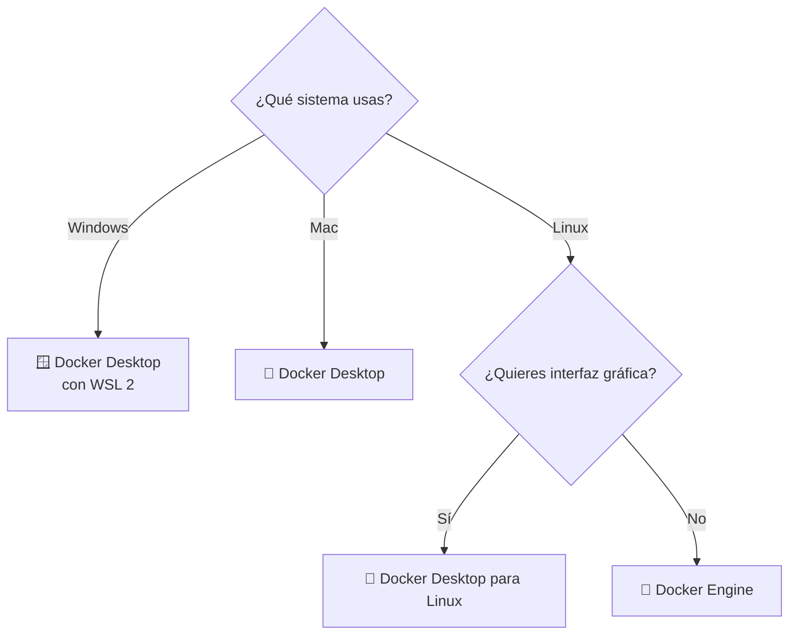
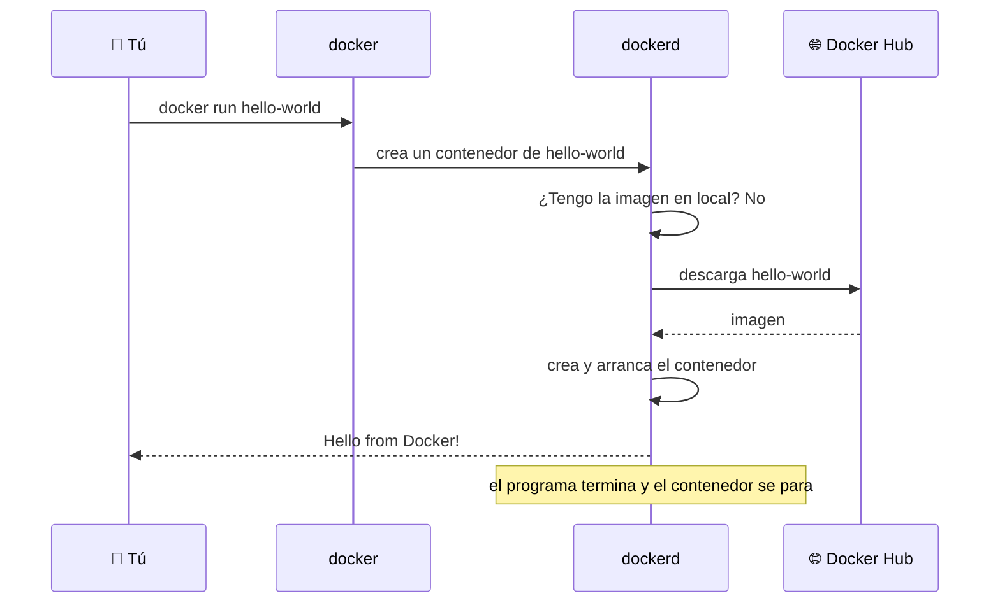
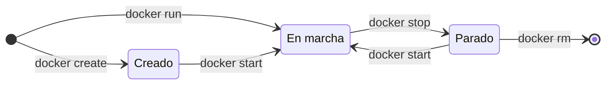
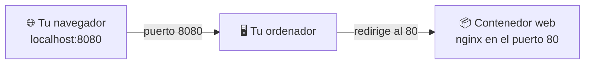

# 🐳 Docker · D03: Instalación y primer contenedor

> 📅 Sábado 17 de octubre de 2026 · ⏱️ 45 min

**🎯 Objetivo:** dejar Docker instalado y funcionando, y ejecutar tus dos primeros contenedores: `hello-world` y un servidor web `nginx`.

| ⏱️ Tiempo | 📚 Bloque |
| :---: | :--- |
| 15 min | 💿 Elegir e instalar Docker |
| 10 min | 👋 Tu primer `docker run` |
| 8 min | 🔄 El ciclo de vida de un contenedor |
| 12 min | 🛠️ Práctica: hello-world y nginx |

---

## 💿 1. Elegir e instalar Docker `15 min`

Hay dos formas de tener Docker. Las dos usan el mismo motor por dentro.

| | 🖥️ Docker Desktop | ⚙️ Docker Engine |
| :--- | :--- | :--- |
| **Qué es** | Una aplicación con ventanas, que incluye todo lo necesario | El motor y la línea de comandos, sin interfaz gráfica |
| **Sistemas** | Windows, Mac y Linux | Linux |
| **Incluye** | Engine, comandos, Compose y panel gráfico | Engine y comandos |
| **Ideal para** | Empezar fácil en Windows o Mac | Servidores y quien prefiere la terminal en Linux |

> [!NOTE]
> Docker Desktop es gratis para uso personal, educación y pequeñas empresas. Las empresas grandes necesitan una licencia de pago.



> 💡 **Recuerda D02:** en Windows y Mac, Docker Desktop crea por debajo una máquina virtual con Linux, porque namespaces y cgroups solo existen en Linux. Tú no lo notas.

### 🪟 Windows

1. Activa la virtualización en la BIOS si no lo está (casi siempre ya lo está).
2. Descarga **Docker Desktop** desde [docker.com](https://www.docker.com/products/docker-desktop/).
3. Durante la instalación deja marcada la opción **WSL 2**.
4. Reinicia si te lo pide y abre Docker Desktop.
5. Espera a que el icono de la ballena deje de moverse: ya está listo.

### 🍎 Mac

1. Descarga **Docker Desktop** y elige tu chip: **Apple silicon** (M1, M2, M3…) o **Intel**.
2. Abre el archivo `.dmg` y arrastra Docker a Aplicaciones.
3. Ábrelo y acepta los permisos.
4. Espera a que el icono de la ballena en la barra de menú deje de moverse.

### 🐧 Linux (Docker Engine)

La forma más corta es el script oficial de instalación:

```bash
curl -fsSL https://get.docker.com -o get-docker.sh
sudo sh get-docker.sh
```

Después, arranca el servicio y permite usar Docker sin `sudo`:

```bash
sudo systemctl enable --now docker
sudo usermod -aG docker $USER
```

Cierra la sesión y vuelve a entrar para que el cambio de grupo se aplique.

> [!TIP]
> Los pasos para cada distribución (Ubuntu, Debian, Fedora…) están en la documentación oficial: [docs.docker.com/engine/install](https://docs.docker.com/engine/install/). El script es cómodo para aprender; para un servidor de producción se recomienda seguir esos pasos.

### ✅ Comprueba que funciona

```bash
docker --version
```

Deberías ver algo como `Docker version 27.x.x`. El número exacto puede ser distinto.

---

## 👋 2. Tu primer `docker run` `10 min`

```bash
docker run hello-world
```

Este comando crea un contenedor a partir de la imagen `hello-world` y lo ejecuta. Es una imagen diminuta que solo imprime un mensaje y termina.



Si ves el mensaje **«Hello from Docker!»**, tu instalación funciona.

| 🔎 Pregunta | 📝 Respuesta |
| :--- | :--- |
| ¿De dónde salió la imagen? | De **Docker Hub**, el registro público de imágenes. Docker la descarga la primera vez. |
| ¿Y la segunda vez? | Ya está en tu ordenador, así que arranca al instante. |
| ¿Por qué se para solo? | Un contenedor vive **mientras viva su proceso principal**. Aquí el proceso imprime el mensaje y acaba. |

### 🧩 Cómo se lee un comando

```text
docker   run   -d   -p 8080:80   --name web   nginx
  │       │     │       │           │          │
  │       │     │       │           │          └─ la imagen que usas
  │       │     │       │           └─ un nombre para el contenedor
  │       │     │       └─ puerto 8080 de tu ordenador → puerto 80 del contenedor
  │       │     └─ en segundo plano (detached)
  │       └─ crea y arranca un contenedor
  └─ el programa
```

---

## 🔄 3. El ciclo de vida de un contenedor `8 min`



| 🎛️ Comando | 📝 Qué hace |
| :--- | :--- |
| `docker run <imagen>` | Crea y arranca un contenedor. |
| `docker ps` | Lista los contenedores **en marcha**. |
| `docker ps -a` | Lista **todos**, también los parados. |
| `docker logs <nombre>` | Muestra lo que ha escrito el contenedor. |
| `docker stop <nombre>` | Para el contenedor con calma. |
| `docker start <nombre>` | Vuelve a arrancar uno parado. |
| `docker rm <nombre>` | Borra un contenedor parado. |
| `docker rm -f <nombre>` | Para y borra a la vez. |
| `docker images` | Lista las imágenes que tienes descargadas. |
| `docker rmi <imagen>` | Borra una imagen. |

> [!TIP]
> Añade `--rm` a `docker run` y el contenedor se borra solo al terminar. Muy útil para pruebas: `docker run --rm hello-world`.

> [!WARNING]
> Un contenedor parado **sigue ocupando espacio** hasta que lo borras con `docker rm`. Acuérdate de D02: se guarda su capa de escritura.

---

## 🛠️ 4. Práctica: hello-world y nginx `12 min`

### Paso 1 · hello-world

```bash
docker run hello-world
docker ps -a
```

Verás tu contenedor en la lista con el estado **Exited**.

### Paso 2 · un servidor web con nginx

```bash
docker run -d -p 8080:80 --name web nginx
```

Abre en el navegador: **http://localhost:8080**

Deberías ver la página **«Welcome to nginx!»**.



### Paso 3 · míralo y páralo

```bash
docker ps
docker logs web
docker stop web
docker ps -a
```

### Paso 4 · límpialo

```bash
docker rm web
docker images
```

### ✅ Comprueba

- [ ] `docker --version` muestra una versión.
- [ ] `docker run hello-world` imprime «Hello from Docker!».
- [ ] Veo la página de nginx en `http://localhost:8080`.
- [ ] Sé distinguir `docker ps` de `docker ps -a`.
- [ ] He parado y borrado el contenedor `web`.

### 🆘 Si algo falla

| ❌ Error | 🔍 Causa | 🔧 Solución |
| :--- | :--- | :--- |
| `permission denied while trying to connect to the Docker daemon socket` | Tu usuario no está en el grupo `docker` (Linux) | Ejecuta `sudo usermod -aG docker $USER` y vuelve a iniciar sesión. Mientras tanto, usa `sudo`. |
| `Cannot connect to the Docker daemon` | Docker no está arrancado | Abre Docker Desktop, o en Linux `sudo systemctl start docker`. |
| `port is already allocated` | Otro programa usa el puerto 8080 | Cambia el puerto: `-p 8081:80` y abre `localhost:8081`. |
| `The container name "/web" is already in use` | Ya existe un contenedor con ese nombre | Bórralo con `docker rm web` o elige otro nombre. |

---

## ⭐ Ideas clave

1. 💿 **Docker Desktop** es la opción fácil para Windows y Mac. **Docker Engine** es la de Linux.
2. ✅ `docker --version` y `docker run hello-world` comprueban que todo funciona.
3. 🌐 Si la imagen no está en tu ordenador, Docker la descarga de **Docker Hub**.
4. ⏳ Un contenedor vive mientras viva su proceso principal.
5. 🔌 Con `-p` conectas un puerto de tu ordenador con uno del contenedor.
6. 🧹 Los contenedores parados siguen ahí: bórralos con `docker rm`.

---

## 🧠 Autoevaluación

Contesta sin mirar los apuntes y compara después.

<details>
<summary>1️⃣ ¿Qué diferencia hay entre Docker Desktop y Docker Engine?</summary>

Docker Desktop es una aplicación con interfaz gráfica para Windows, Mac y Linux. Docker Engine es solo el motor y los comandos, y se usa en Linux.

</details>

<details>
<summary>2️⃣ ¿Qué hace `docker run hello-world` si no tienes la imagen?</summary>

La descarga de Docker Hub, crea un contenedor, lo ejecuta y muestra el mensaje.

</details>

<details>
<summary>3️⃣ ¿Por qué el contenedor `hello-world` se para solo?</summary>

Porque un contenedor vive mientras viva su proceso principal, y ese proceso termina al imprimir el mensaje.

</details>

<details>
<summary>4️⃣ ¿Qué significa `-p 8080:80`?</summary>

Que el puerto 8080 de tu ordenador se conecta con el puerto 80 del contenedor.

</details>

<details>
<summary>5️⃣ ¿Cómo ves los contenedores parados?</summary>

Con `docker ps -a`.

</details>

<details>
<summary>6️⃣ ¿Cómo paras y borras un contenedor llamado `web`?</summary>

`docker stop web` y después `docker rm web`. También vale `docker rm -f web` para hacerlo en un paso.

</details>

---

➡️ **Siguiente sesión, D04:** Docker CLI (comandos de imágenes, contenedores, volúmenes y redes).