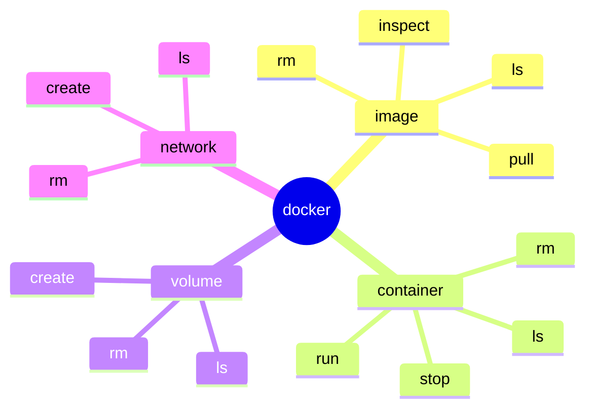
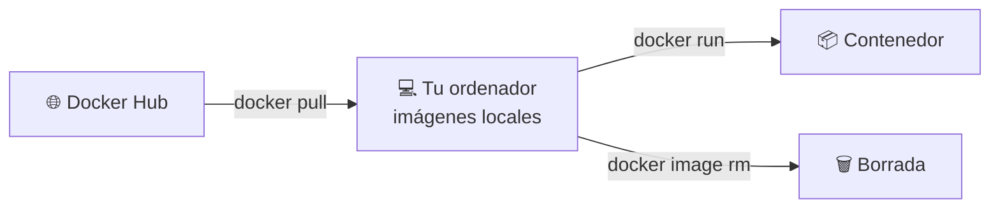
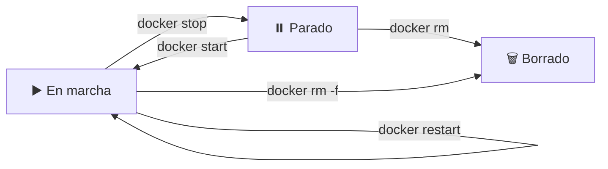
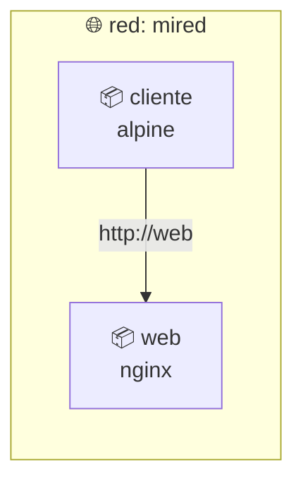

# 🐳 Docker · D04: Docker CLI

> 📅 Domingo 18 de octubre de 2026 · ⏱️ 60 min

**🎯 Objetivo:** manejar con soltura los comandos de Docker para **imágenes, contenedores, volúmenes y redes**, y saber crear, inspeccionar, parar y borrar contenedores.

| ⏱️ Tiempo | 📚 Bloque |
| :---: | :--- |
| 8 min | 🧭 Cómo está organizada la CLI |
| 12 min | 🖼️ Comandos de imágenes |
| 18 min | 📦 Comandos de contenedores |
| 8 min | 💾 Volúmenes y 🌐 redes (primer vistazo) |
| 14 min | 🛠️ Práctica |

---

## 🧭 1. Cómo está organizada la CLI `8 min`

Recuerda D02: `docker` es el **cliente**. Tú escribes un comando y él se lo pasa al servicio `dockerd`.

Casi todos los comandos siguen el mismo patrón:

```text
docker   <objeto>   <acción>   [opciones]   [nombre]
  │         │          │
  │         │          └─ qué quieres hacer: ls, inspect, rm…
  │         └─ sobre qué: image, container, volume, network
  └─ el programa
```



> [!TIP]
> Hay **atajos** muy usados que te ahorran escribir. Hacen lo mismo que la forma larga.

| ⌨️ Atajo | 🔤 Forma larga |
| :--- | :--- |
| `docker ps` | `docker container ls` |
| `docker images` | `docker image ls` |
| `docker rmi` | `docker image rm` |
| `docker rm` | `docker container rm` |
| `docker run` | `docker container run` |

### 🆘 La ayuda siempre está a mano

```bash
docker --help
docker container --help
docker run --help
```

---

## 🖼️ 2. Imágenes `12 min`

### 🏷️ El nombre de una imagen

```text
docker.io  /  library  /  nginx  :  1.27
    │            │          │         │
    │            │          │         └─ etiqueta (la versión)
    │            │          └─ nombre de la imagen
    │            └─ usuario u organización («library» = imágenes oficiales)
    └─ registro (Docker Hub por defecto)
```

Casi siempre escribes solo `nginx:1.27`. Lo demás se rellena solo.

> [!WARNING]
> Si no pones etiqueta, Docker usa `latest`. Esa etiqueta es solo el valor por defecto: **no garantiza que sea la versión más nueva**. Para algo serio, indica siempre una versión.

### 🎛️ Comandos

| 🎛️ Comando | 📝 Qué hace |
| :--- | :--- |
| `docker pull nginx:alpine` | Descarga una imagen de Docker Hub. |
| `docker image ls` | Lista las imágenes que tienes en tu ordenador. |
| `docker search nginx` | Busca imágenes en Docker Hub. |
| `docker image inspect nginx:alpine` | Muestra todos sus datos (capas, configuración, tamaño). |
| `docker image history nginx:alpine` | Muestra las capas y cómo se construyó. |
| `docker image rm nginx:alpine` | Borra una imagen. |
| `docker image prune` | Borra las imágenes «huérfanas», sin etiqueta y sin usar. |



> 💡 **Recuerda D02:** una imagen son capas de solo lectura. `docker image history` te enseña esas capas.

---

## 📦 3. Contenedores `18 min`

### ▶️ Crear y arrancar con `docker run`

```bash
docker run [opciones] <imagen> [comando]
```

| 🚩 Opción | 📝 Para qué sirve | 💡 Ejemplo |
| :---: | :--- | :--- |
| `-d` | Ejecutar en segundo plano | `docker run -d nginx` |
| `--name` | Ponerle un nombre | `--name web` |
| `-p` | Conectar un puerto de tu ordenador | `-p 8080:80` |
| `-e` | Pasar una variable de entorno | `-e MODO=prueba` |
| `-it` | Abrir una terminal dentro | `docker run -it alpine sh` |
| `--rm` | Borrarlo solo al terminar | `docker run --rm alpine echo hola` |

> [!NOTE]
> `-it` son dos opciones juntas: `-i` mantiene la entrada abierta y `-t` te da una terminal. Para salir de la terminal escribe `exit`.

### 👀 Ver qué pasa

| 🎛️ Comando | 📝 Qué hace |
| :--- | :--- |
| `docker ps` | Contenedores en marcha. |
| `docker ps -a` | Todos, también los parados. |
| `docker logs web` | Lo que ha escrito el contenedor. |
| `docker logs -f web` | Lo mismo, y sigue mostrando líneas nuevas (sal con `Ctrl+C`). |
| `docker inspect web` | Todos sus datos en formato JSON. |
| `docker stats` | Uso de CPU y memoria en directo. |
| `docker top web` | Los procesos que corren dentro. |

Para sacar un solo dato de `inspect`:

```bash
docker inspect --format '{{.State.Status}}' web
```

### 🚪 Entrar en un contenedor que ya corre

```bash
docker exec -it web sh
```

`exec` ejecuta un comando **dentro de un contenedor en marcha**. Con `sh` abres una terminal.

### 🔄 Parar, arrancar y borrar



| 🎛️ Comando | 📝 Qué hace |
| :--- | :--- |
| `docker stop web` | Pide al contenedor que termine y espera hasta 10 segundos. |
| `docker kill web` | Lo corta de golpe, sin esperar. |
| `docker start web` | Arranca uno parado. |
| `docker restart web` | Lo para y lo vuelve a arrancar. |
| `docker rm web` | Borra un contenedor parado. |
| `docker rm -f web` | Lo para y lo borra a la vez. |
| `docker container prune` | Borra **todos** los contenedores parados. |

> [!TIP]
> Puedes dar varios nombres a la vez: `docker stop web1 web2`.

---

## 💾 4. Volúmenes y 🌐 redes: primer vistazo `8 min`

Aquí solo conoces los comandos. Los volúmenes se estudian a fondo en **D06** y las redes en **D10**.

### 💾 Volúmenes: guardar datos fuera del contenedor

Recuerda: la capa de escritura de un contenedor se borra con él. Un volumen guarda los datos aparte.

| 🎛️ Comando | 📝 Qué hace |
| :--- | :--- |
| `docker volume create datos` | Crea un volumen. |
| `docker volume ls` | Lista los volúmenes. |
| `docker volume inspect datos` | Muestra sus datos y dónde se guarda. |
| `docker volume rm datos` | Borra un volumen. |
| `docker volume prune` | Borra los volúmenes que ningún contenedor usa. |

Se conecta a un contenedor con `-v nombre:ruta`:

```bash
docker run --rm -v datos:/data alpine sh -c "echo hola > /data/nota.txt"
docker run --rm -v datos:/data alpine cat /data/nota.txt
```

El segundo contenedor imprime `hola`: el archivo sobrevivió aunque el primero se borró.

### 🌐 Redes: que los contenedores se hablen

| 🎛️ Comando | 📝 Qué hace |
| :--- | :--- |
| `docker network ls` | Lista las redes. Verás `bridge`, `host` y `none`. |
| `docker network create mired` | Crea una red propia. |
| `docker network inspect mired` | Muestra sus datos y qué contenedores tiene. |
| `docker network rm mired` | Borra una red. |



En una red propia, los contenedores se encuentran **por su nombre**:

```bash
docker network create mired
docker run -d --name web --network mired nginx:alpine
docker run --rm --network mired alpine wget -qO- http://web
```

La última línea imprime la página de bienvenida de nginx.

---

## 🧹 Limpieza

```bash
docker system df       # cuánto espacio usa Docker
docker system prune    # borra lo que no se usa
```

> [!WARNING]
> `docker system prune` borra contenedores parados, redes sin usar e imágenes huérfanas. **No** toca los volúmenes, salvo que añadas `--volumes`: entonces **sí borra datos**. Úsalo con cuidado.

---

## 🛠️ 5. Práctica: crear, parar, inspeccionar y borrar `14 min`

### Paso 1 · descarga imágenes

```bash
docker pull nginx:alpine
docker pull alpine
docker image ls
```

### Paso 2 · crea dos contenedores

```bash
docker run -d --name web1 -p 8081:80 nginx:alpine
docker run -d --name web2 -p 8082:80 nginx:alpine
docker ps
```

Abre `http://localhost:8081` y `http://localhost:8082`. Verás nginx dos veces, cada uno en su contenedor.

### Paso 3 · inspecciona

```bash
docker logs web1
docker inspect --format '{{.State.Status}}' web1
docker stats --no-stream
docker top web1
```

### Paso 4 · entra y mira dentro

```bash
docker exec -it web1 sh
ls /usr/share/nginx/html
exit
```

### Paso 5 · para y borra

```bash
docker stop web1 web2
docker ps -a
docker rm web1 web2
docker ps -a
```

### Paso 6 · reto con volumen y red

```bash
docker volume create datos
docker network create mired
docker volume ls
docker network ls
docker volume rm datos
docker network rm mired
```

### Paso 7 · limpia

```bash
docker image rm nginx:alpine alpine
docker system df
```

### ✅ Comprueba

- [ ] He descargado una imagen con `docker pull` y la veo con `docker image ls`.
- [ ] He creado dos contenedores con nombres distintos y puertos distintos.
- [ ] Sé ver los registros y el estado de un contenedor.
- [ ] He entrado en un contenedor con `docker exec -it`.
- [ ] He parado y borrado los contenedores.
- [ ] He creado y borrado un volumen y una red.

### 🆘 Si algo falla

| ❌ Error | 🔧 Solución |
| :--- | :--- |
| `No such container: web1` | Revisa el nombre con `docker ps -a`. |
| `port is already allocated` | Cambia el puerto de la izquierda: `-p 8083:80`. |
| `conflict: unable to remove repository reference… container is using its image` | Borra primero los contenedores que usan esa imagen. |
| `volume is in use` o `network has active endpoints` | Borra primero el contenedor que lo usa. |

---

## 🗂️ Chuleta rápida

| 🎯 Quiero… | ⌨️ Comando |
| :--- | :--- |
| Descargar una imagen | `docker pull <imagen>` |
| Ver mis imágenes | `docker image ls` |
| Crear y arrancar un contenedor | `docker run -d --name <n> <imagen>` |
| Ver los contenedores | `docker ps` / `docker ps -a` |
| Ver sus registros | `docker logs <n>` |
| Entrar en uno | `docker exec -it <n> sh` |
| Pararlo / arrancarlo | `docker stop <n>` / `docker start <n>` |
| Borrar un contenedor | `docker rm <n>` |
| Borrar una imagen | `docker image rm <imagen>` |
| Crear un volumen | `docker volume create <n>` |
| Crear una red | `docker network create <n>` |
| Limpiar lo que sobra | `docker system prune` |

---

## ⭐ Ideas clave

1. 🧭 Los comandos siguen el patrón `docker <objeto> <acción>`.
2. 🖼️ `docker pull` descarga imágenes; siempre es mejor indicar la versión.
3. 📦 `docker run` crea y arranca; `docker ps -a` muestra todos los contenedores.
4. 🚪 `docker exec -it` te mete en un contenedor que ya está en marcha.
5. 🛑 `stop` pide que termine con calma; `kill` lo corta de golpe.
6. 💾 Los volúmenes guardan datos fuera del contenedor.
7. 🌐 En una red propia, los contenedores se encuentran por nombre.

---

## 🧠 Autoevaluación

Contesta sin mirar los apuntes y compara después.

<details>
<summary>1️⃣ ¿Qué diferencia hay entre <code>docker ps</code> y <code>docker ps -a</code>?</summary>

`docker ps` muestra solo los contenedores en marcha. Con `-a` muestra también los parados.

</details>

<details>
<summary>2️⃣ ¿Qué diferencia hay entre <code>docker run</code> y <code>docker exec</code>?</summary>

`run` crea un contenedor nuevo a partir de una imagen. `exec` ejecuta un comando dentro de un contenedor que ya está en marcha.

</details>

<details>
<summary>3️⃣ ¿Qué significa <code>-it</code>?</summary>

`-i` mantiene la entrada abierta y `-t` abre una terminal. Juntas te dejan escribir comandos dentro del contenedor.

</details>

<details>
<summary>4️⃣ ¿Qué diferencia hay entre <code>docker stop</code> y <code>docker kill</code>?</summary>

`stop` pide al contenedor que termine y espera hasta 10 segundos. `kill` lo corta de golpe.

</details>

<details>
<summary>5️⃣ ¿Por qué no conviene usar siempre la etiqueta <code>latest</code>?</summary>

Porque es solo la etiqueta por defecto y puede apuntar a versiones distintas con el tiempo. Indicar la versión hace que todos usen lo mismo.

</details>

<details>
<summary>6️⃣ ¿Qué ventaja tiene crear una red propia?</summary>

Que los contenedores de esa red se encuentran por su nombre, por ejemplo `http://web`.

</details>

<details>
<summary>7️⃣ ¿Qué hace <code>docker system prune --volumes</code> y por qué es peligroso?</summary>

Borra lo que no se usa y también los volúmenes sin usar, así que puede eliminar datos que quieras conservar.

</details>

---

➡️ **Siguiente sesión, D05:** imágenes de terceros (bases de datos y utilidades desde Docker Hub).