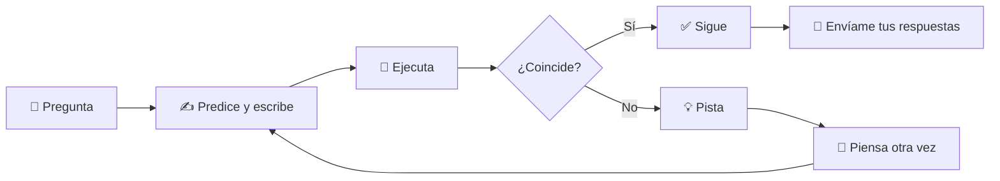
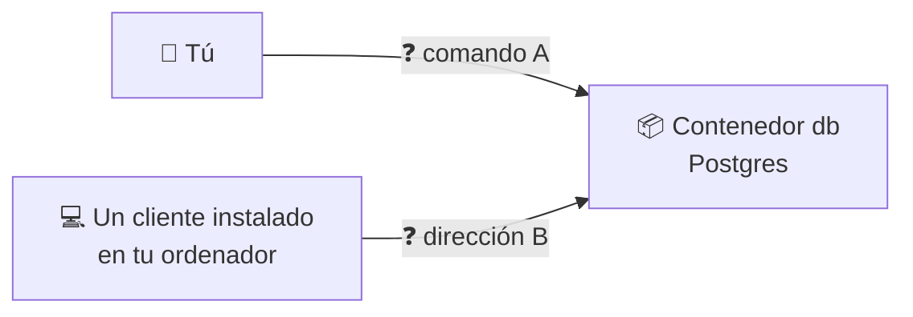
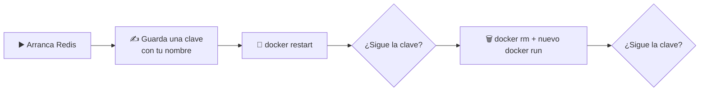
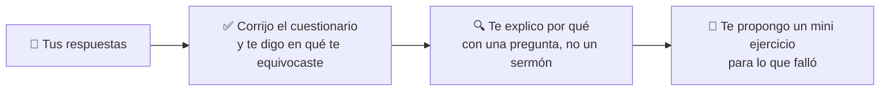

# 🐳 Docker · D05 (modo socrático): Imágenes de terceros

> 📅 Lunes 19 de octubre de 2026 · ⏱️ 45 min

**🎯 Objetivo:** aprender a elegir y usar imágenes de Docker Hub (bases de datos y herramientas) **descubriéndolo tú**. Aquí no hay respuestas: hay preguntas, pistas y experimentos. La terminal es el juez.

---

## 🧭 Cómo funciona este cuaderno

| Icono | Qué significa |
| :---: | :--- |
| 🤔 | **Pregunta** para pensar |
| ✍️ | **Escribe tu respuesta** antes de seguir (en papel o en un archivo) |
| 💡 | **Pista**. Ábrelas de una en una y solo si te atascas |
| 🧪 | **Experimento**: ejecútalo y compara con lo que predijiste |
| 🎯 | **Reto** |
| 📮 | Lo que me envías al final |



> [!IMPORTANT]
> **Regla de oro:** primero predice, después ejecuta. Equivocarte en la predicción es donde más se aprende. No busques la respuesta antes de escribir la tuya.

| ⏱️ Tiempo | 📚 Bloque |
| :---: | :--- |
| 7 min | 📝 Calentamiento: cuestionario de D04 |
| 8 min | 🔎 Parte 1: elegir una imagen |
| 15 min | 🗄️ Parte 2: bases de datos |
| 7 min | 🧰 Parte 3: herramientas sin instalar |
| 8 min | 🎯 Parte 4: reto y reflexión |

### 📊 Mi progreso

- [ ] Calentamiento D04
- [ ] Parte 1: elegir una imagen
- [ ] Parte 2: bases de datos
- [ ] Parte 3: herramientas sin instalar
- [ ] Parte 4: reto y reflexión
- [ ] Respuestas enviadas

---

## 📝 Calentamiento: ¿qué recuerdas de D04? `7 min`

Contesta **sin mirar los apuntes**. Después me envías tus respuestas y te diré en qué te has equivocado y por qué.

### 1️⃣ Contenedor parado

Paraste el contenedor `web` con `docker stop web` y `docker ps` ya no lo muestra. ¿Qué comando usas para comprobar que sigue existiendo?

- **A)** `docker ls`
- **B)** `docker ps -a`
- **C)** `docker images`
- **D)** `docker logs`

### 2️⃣ Terminal dentro de un contenedor

El contenedor `web` está en marcha. Quieres abrir una terminal **dentro de ese mismo contenedor**. ¿Qué comando usas?

- **A)** `docker run -it web sh`
- **B)** `docker exec -it web sh`
- **C)** `docker start -it web sh`
- **D)** `docker logs -it web sh`

### 3️⃣ Parar con calma o de golpe

¿Qué diferencia hay entre `docker stop` y `docker kill`?

- **A)** `stop` borra el contenedor y `kill` solo lo para
- **B)** `stop` pide que termine y espera unos segundos; `kill` lo corta de golpe
- **C)** Son idénticos
- **D)** `kill` pide que termine y `stop` lo corta de golpe

### 4️⃣ El nombre de una imagen

En `docker.io/library/nginx:1.27`, ¿qué es `library`?

- **A)** La versión
- **B)** El registro
- **C)** El espacio donde viven las imágenes oficiales
- **D)** El nombre del contenedor

### 5️⃣ Verdadero o falso

> «Si no escribo etiqueta, Docker usa `latest`, y `latest` siempre es la versión más nueva».

✍️ Responde **Verdadero** o **Falso** y justifícalo en una frase.

### 6️⃣ Redes

Creas la red `mired` y arrancas dos contenedores en ella: `web` y `cliente`. ¿Cómo llega `cliente` a `web`?

- **A)** Con la dirección `127.0.0.1`
- **B)** Usando el nombre `web`, por ejemplo `http://web`
- **C)** No pueden comunicarse
- **D)** Solo si `web` publica un puerto con `-p`

### 7️⃣ Borrar a la fuerza

Un contenedor `web` **sigue en marcha**. Ejecutas `docker rm -f web`. ¿Qué ocurre?

- **A)** Da un error
- **B)** Lo para y lo borra
- **C)** Solo lo para
- **D)** Borra también su imagen

### 8️⃣ Volúmenes

Guardaste `nota.txt` con este comando, y ese contenedor ya se borró por el `--rm`:

```bash
docker run --rm -v datos:/data alpine sh -c "echo hola > /data/nota.txt"
```

Ahora ejecutas:

```bash
docker run --rm -v datos:/data alpine cat /data/nota.txt
```

✍️ ¿Qué imprime y **por qué**?

---

## 🔎 Parte 1: elegir una imagen `8 min`

### 🤔 1.1 Tres candidatas

Necesitas Postgres y Docker Hub te da estos resultados *(cifras de ejemplo; las imágenes B y C son inventadas)*:

| | Imagen | Sello | Descargas | Última actualización |
| :---: | :--- | :--- | ---: | :--- |
| **A** | `postgres` | Docker Official Image | +1.000 M | hace 3 días |
| **B** | `pgfacil/postgres-listo` | ninguno | 4.200 | hace 3 años |
| **C** | `acmedb/postgres` | Verified Publisher | 12 M | hace 1 semana |

✍️ Ordénalas de **más a menos fiable** y escribe **en qué datos te has fijado**.

<details>
<summary>💡 Pista 1</summary>

Mira cada columna de la tabla y pregúntate qué te dice sobre quién la mantiene.

</details>

<details>
<summary>💡 Pista 2</summary>

Una imagen que lleva años sin actualizarse puede arrastrar fallos de seguridad que ya se corrigieron en otras.

</details>

### 🤔 1.2 La tentación

Imagina que **B** trae justo un extra que necesitas y las otras no. ✍️ Nombra **al menos dos comprobaciones** que harías antes de ejecutarla.

<details>
<summary>💡 Pista 1</summary>

En la página de la imagen en Docker Hub hay más que la tabla de arriba. ¿Qué documentación o código puedes leer?

</details>

<details>
<summary>💡 Pista 2</summary>

Piensa en lo que pasaría si esa imagen hiciera algo que no esperas. ¿Con qué datos o permisos la probarías?

</details>

### 🧪 1.3 Busca desde la terminal

```bash
docker search postgres --limit 5
```

✍️ **Antes de ejecutar:** ¿en qué columna esperas ver si una imagen es oficial?

### 🧪 1.4 Las etiquetas

Tienes tres etiquetas de la misma imagen: `postgres:17`, `postgres:17-alpine` y `postgres:latest`.

✍️ **Predice:**
1. ¿Cuál **pesará menos**?
2. ¿Cuál tiene **más riesgo** de que tu proyecto se comporte distinto dentro de unos meses?

Después verifica el tamaño:

```bash
docker pull postgres:17
docker pull postgres:17-alpine
docker image ls postgres
```

✍️ ¿Acertaste? ¿Qué diferencia de tamaño ves, aproximadamente?

---

## 🗄️ Parte 2: bases de datos `15 min`

### 🧪 2.1 Arrancar sin contraseña

```bash
docker run -d --name db0 postgres:17
```

✍️ **Antes de seguir, predice:**
1. ¿Qué mostrará `docker ps`?
2. ¿Y `docker ps -a`?
3. ¿Dónde mirarías para saber **por qué**?

Ahora compruébalo y limpia:

```bash
docker ps
docker ps -a
docker rm db0
```

<details>
<summary>💡 Pista 1</summary>

En D04 viste un comando para leer lo que ha escrito un contenedor.

</details>

<details>
<summary>💡 Pista 2</summary>

Lee el mensaje con calma: te dice qué le falta a la imagen para arrancar.

</details>

### 🧪 2.2 Arrancar bien

Con lo que has leído en el mensaje, arranca Postgres **tú solo**. Necesitas nombre `db`, el puerto 5432 publicado y la variable que faltaba.

✍️ Escribe el comando completo que has usado:

```text
docker run ...
```

<details>
<summary>💡 Pista 1</summary>

Las variables de entorno se pasan con `-e NOMBRE=valor`.

</details>

<details>
<summary>💡 Pista 2</summary>

El mensaje de error del ejercicio anterior incluye el **nombre exacto** de la variable.

</details>

🤔 ¿Cómo sabes que Postgres **ya está listo** para recibir conexiones? ✍️ ¿Qué comando usas y qué frase buscas?

### 🤔 2.3 Dos caminos para conectarte



✍️ ¿Qué va en **A** y qué va en **B**?
✍️ ¿Cuál de los dos caminos funciona **aunque no hubieras usado `-p`**? ¿Por qué?

<details>
<summary>💡 Pista 1</summary>

Uno de los caminos entra *dentro* del contenedor y usa herramientas que ya trae. Piensa en `docker exec`.

</details>

<details>
<summary>💡 Pista 2</summary>

El cliente de Postgres se llama `psql` y el usuario por defecto se llama `postgres`.

</details>

### 🧪 2.4 Tu primera tabla

Entra en Postgres con el camino A.

✍️ **Escribe tú las sentencias SQL** para:
1. Crear una tabla `tareas` con dos columnas: un `id` automático y un `texto`.
2. Insertar **dos tareas**.
3. Leer todas las filas.

<details>
<summary>💡 Pista 1</summary>

Las tres sentencias empiezan por `CREATE TABLE`, `INSERT INTO` y `SELECT`.

</details>

<details>
<summary>💡 Pista 2</summary>

Dentro de `psql`, `\dt` lista las tablas y `\q` sale.

</details>

### 🤔 2.5 ¿Y si borro el contenedor?

Vas a borrar `db` y crear otro igual.

✍️ **Predice:**
1. ¿Seguirá existiendo la tabla `tareas`?
2. ¿**Por qué** sí o por qué no? Usa lo que viste en D02 sobre capas.

Verifica:

```bash
docker rm -f db
docker run -d --name db -e POSTGRES_PASSWORD=secreto -p 5432:5432 postgres:17
docker exec -it db psql -U postgres -c "SELECT * FROM tareas;"
```

✍️ ¿Qué ha pasado? ¿Coincide con tu predicción?

### 🧪 2.6 Una pista inesperada

Después de borrar el primer contenedor, ejecuta:

```bash
docker volume ls
```

✍️ **Responde:**
1. ¿Qué ves en la lista?
2. ¿De dónde crees que ha salido eso, si **tú no creaste ningún volumen**?
3. ¿Por qué el contenedor nuevo no ha usado esos datos?

<details>
<summary>💡 Pista 1</summary>

Fíjate en el nombre del volumen. ¿Lo has puesto tú?

</details>

<details>
<summary>💡 Pista 2</summary>

Las imágenes pueden pedir a Docker que guarde ciertas carpetas fuera de la capa de escritura. ¿Qué pasa con eso al borrar el contenedor?

</details>

> 📌 Guarda tus conclusiones: en **D06** vas a aprender a controlar esto tú mismo.

### 🧪 2.7 ¿Dónde queda tu contraseña?

La pusiste con `-e`.

✍️ **Predice:** ¿puede verla alguien que pueda ejecutar comandos de Docker en tu ordenador? ¿Con qué comando?

Verifica:

```bash
docker inspect --format '{{.Config.Env}}' db
```

### 🤔 2.8 ¿Quién puede entrar?

Tu comando incluía `-p 5432:5432`.

✍️ **Responde:**
1. ¿Qué otros equipos de tu red podrían intentar conectarse a ese puerto?
2. ¿Cómo lo limitarías para que solo se pueda usar **desde tu ordenador**?

<details>
<summary>💡 Pista 1</summary>

La parte izquierda de `-p` puede llevar **una dirección** delante del número de puerto.

</details>

<details>
<summary>💡 Pista 2</summary>

¿Cuál es la dirección que siempre significa «este mismo ordenador»?

</details>

### 🎯 2.9 Descubre otras bases de datos

Completa la tabla. Para **Redis** y **MySQL**, busca la información tú en la página de la imagen en Docker Hub (apartado de documentación).

| | 🐘 Postgres | ⚡ Redis | 🐬 MySQL |
| :--- | :--- | :--- | :--- |
| **Imagen** | `postgres` | ❓ | ❓ |
| **Variable obligatoria** | `POSTGRES_PASSWORD` | ❓ | ❓ |
| **Puerto** | 5432 | ❓ | ❓ |
| **Cliente dentro** | `psql` | ❓ | ❓ |

<details>
<summary>💡 Pista</summary>

Una de las dos columnas vacías **no necesita** ninguna variable obligatoria para arrancar.

</details>

---

## 🧰 Parte 3: herramientas sin instalar `7 min`

### 🤔 3.1 Ventajas

Puedes ejecutar Python así, sin instalarlo:

```bash
docker run --rm python:3.12 python --version
```

✍️ Escribe **tres ventajas** frente a instalar Python en tu ordenador.

### 🧪 3.2 El papel de `--rm`

✍️ **Predice:** después de ejecutar el comando de arriba, ¿aparecerá un contenedor en `docker ps -a`? ¿Y si quitas el `--rm`?

Verifica las dos versiones:

```bash
docker run --rm python:3.12 python --version
docker ps -a
docker run python:3.12 python --version
docker ps -a
```

Limpia después con `docker container prune`.

### 🧪 3.3 Dos versiones a la vez

```bash
docker run --rm python:3.11 python --version
docker run --rm python:3.12 python --version
```

✍️ ¿Qué te dice esto sobre tener **varias versiones** de una misma herramienta?

### 🎯 3.4 Tu propio script

Crea `hola.py` en una carpeta con este contenido:

```python
print("hola desde un contenedor")
```

Completa el comando para que el contenedor **vea tu archivo** y lo ejecute:

```text
docker run --rm ❓ ❓ python:3.12 python hola.py
```

✍️ Escribe qué has puesto en cada ❓ y para qué sirve cada opción.

<details>
<summary>💡 Pista 1</summary>

En D04 usaste `-v nombre:ruta` con un **volumen**. Aquí, en lugar del nombre del volumen, va una carpeta de tu ordenador.

</details>

<details>
<summary>💡 Pista 2</summary>

La carpeta actual se escribe `"$PWD"`. La ruta dentro del contenedor la eliges tú, por ejemplo `/app`. La otra opción elige **en qué carpeta trabaja** el comando.

</details>

> [!NOTE]
> Si ves `Permission denied` en Fedora u otra distribución con SELinux, añade `:Z` al final de la ruta del contenedor, por ejemplo `/app:Z`.

---

## 🎯 Parte 4: reto y reflexión `8 min`

### 🎯 4.1 Reto con Redis



✍️ **Predice los dos ❓ antes de ejecutar** y razónalo con lo que has aprendido en esta sesión.

Después demuéstralo con comandos. Los que necesitas son de D04 y D05.

<details>
<summary>💡 Pista 1</summary>

La clave se guarda con `SET` y se lee con `GET` dentro de `redis-cli`.

</details>

<details>
<summary>💡 Pista 2</summary>

Recuerda el experimento 2.6: mira `docker volume ls` y piensa qué le pasa a un volumen sin nombre al crear un contenedor nuevo.

</details>

### 🤔 4.2 Para un compañero

✍️ Un compañero va a copiar un comando de Internet con una imagen que no conoce. En **tres frases**, ¿qué le recomendarías mirar y qué opciones evitar?

### 📈 4.3 ¿Qué tal me ha ido?

Puntúa tu seguridad de **1** (nada) a **5** (podría enseñarlo):

| Tema | 1 | 2 | 3 | 4 | 5 |
| :--- | :-: | :-: | :-: | :-: | :-: |
| Elegir una imagen en Docker Hub | ☐ | ☐ | ☐ | ☐ | ☐ |
| Etiquetas y versiones | ☐ | ☐ | ☐ | ☐ | ☐ |
| Arrancar una base de datos con `-e` y `-p` | ☐ | ☐ | ☐ | ☐ | ☐ |
| Conectarme con `exec` o por puerto | ☐ | ☐ | ☐ | ☐ | ☐ |
| Usar herramientas con `--rm` | ☐ | ☐ | ☐ | ☐ | ☐ |

---

## 📮 Entrega: envíame tus respuestas

Copia esta plantilla en el chat y rellénala. Si no sabes algo, escribe `no sé`: es útil para mí.

```text
CUESTIONARIO D04
1:  2:  3:  4:
5 (V/F + motivo):
6:  7:
8:

PARTE 1
1.1 orden y datos:
1.2 comprobaciones:
1.3 predicción:
1.4 predicción y resultado:

PARTE 2
2.1 predicción:
2.2 comando:
2.2 cómo sé que está listo:
2.3 A / B / cuál funciona sin -p:
2.4 SQL:
2.5 predicción y resultado:
2.6 respuestas:
2.7 predicción:
2.8 respuestas:
2.9 tabla:

PARTE 3
3.1 ventajas:
3.2 predicción:
3.3 conclusión:
3.4 comando y opciones:

PARTE 4
4.1 predicciones y resultado:
4.2 consejo:
4.3 mi confianza (1-5) por tema:
```

### 🔁 Qué haré yo con tus respuestas



---

➡️ **Siguiente sesión, D06:** persistencia de datos. Lo que descubras en los experimentos 2.5 y 2.6 será tu punto de partida.