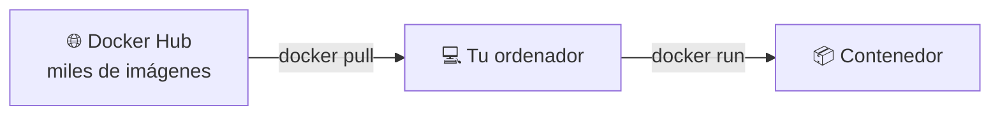
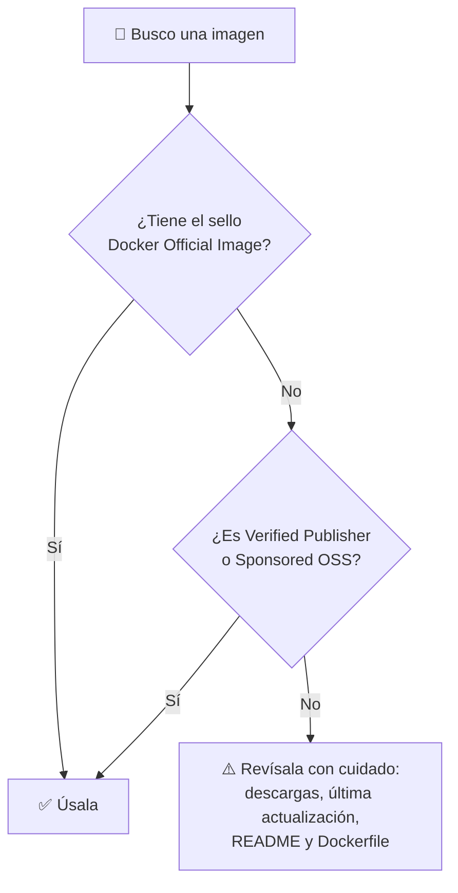
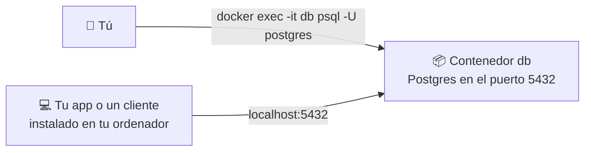
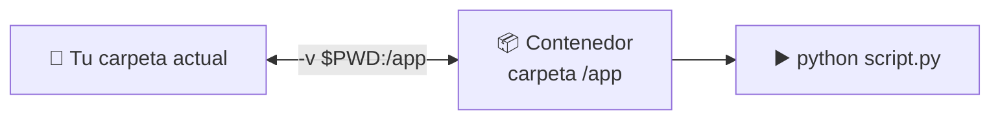

# 🐳 Docker · D05: Imágenes de terceros

> 📅 Lunes 19 de octubre de 2026 · ⏱️ 45 min

**🎯 Objetivo:** usar imágenes que ha hecho otra gente (bases de datos y herramientas de línea de comandos) desde Docker Hub, elegirlas con criterio y conectarte a ellas.

| ⏱️ Tiempo | 📚 Bloque |
| :---: | :--- |
| 10 min | 🔎 Docker Hub y cómo elegir una imagen |
| 15 min | 🗄️ Bases de datos en contenedores |
| 8 min | 🧰 Utilidades de línea de comandos |
| 12 min | 🛠️ Práctica: Postgres y Redis |

---

## 🔎 1. Docker Hub y cómo elegir una imagen `10 min`

No hace falta construir todo desde cero. **Docker Hub** ([hub.docker.com](https://hub.docker.com)) es la biblioteca pública donde miles de personas y empresas publican imágenes listas para usar.



### 🏅 Quién la ha hecho

| 🏷️ Sello | 📝 Qué significa | 🚦 Confianza |
| :--- | :--- | :---: |
| **Docker Official Image** | Mantenida con Docker, con documentación y actualizaciones. Ejemplos: `postgres`, `redis`, `nginx`. | ✅ Alta |
| **Verified Publisher** | Publicada por una empresa verificada por Docker. | ✅ Alta |
| **Sponsored OSS** | Proyecto de código abierto apoyado por Docker. | ✅ Alta |
| *Sin sello* | La ha subido cualquier persona. | ⚠️ Revísala |



### 🔍 Qué mirar antes de usarla

- [ ] **Sello:** oficial o verificada es lo mejor.
- [ ] **Descargas:** millones de descargas suelen indicar que es de fiar.
- [ ] **Última actualización:** si lleva años sin cambios, puede tener fallos de seguridad.
- [ ] **README:** explica las variables, los puertos y los volúmenes que necesita.
- [ ] **Etiquetas (tags):** mira qué versiones hay disponibles.

Buscar desde la terminal:

```bash
docker search postgres
```

La columna `OFFICIAL` marca con `[OK]` las oficiales.

> [!WARNING]
> Una imagen de terceros **ejecuta código que no has escrito tú**. Usa imágenes oficiales siempre que puedas, fija la versión y no uses opciones como `--privileged` sin entender qué hacen.

### 🏷️ Variantes de etiqueta

Una misma imagen suele tener varias etiquetas:

| 🏷️ Etiqueta | 📝 Qué es |
| :--- | :--- |
| `postgres:17` | La versión 17 con Debian, la variante normal. |
| `postgres:17-alpine` | La versión 17 sobre Alpine Linux: **mucho más ligera**. |
| `python:3.12-slim` | Debian reducido: menos tamaño que la normal. |
| `postgres:latest` | La etiqueta por defecto. **Evítala**: puede cambiar con el tiempo. |

> [!NOTE]
> Docker Hub limita las descargas si no has iniciado sesión. Si ves el error `toomanyrequests`, espera un rato o inicia sesión con `docker login`.

---

## 🗄️ 2. Bases de datos en contenedores `15 min`

Instalar una base de datos en tu ordenador es lento y la deja ahí para siempre. Con Docker, **la arrancas en segundos y la borras sin dejar rastro**. Ideal para aprender y para desarrollar.

### 🐘 Postgres

```bash
docker run -d --name db -e POSTGRES_PASSWORD=secreto -p 5432:5432 postgres:17
```

```text
docker run  -d  --name db  -e POSTGRES_PASSWORD=secreto  -p 5432:5432  postgres:17
              │      │              │                        │             │
              │      │              │                        │             └─ imagen oficial y versión
              │      │              │                        └─ puerto de tu ordenador → puerto de Postgres
              │      │              └─ variable de entorno: la contraseña (obligatoria)
              │      └─ nombre del contenedor
              └─ en segundo plano
```

> [!IMPORTANT]
> Las imágenes de bases de datos se configuran con **variables de entorno** (`-e`). Cada imagen tiene las suyas: mira el README en Docker Hub. Sin `POSTGRES_PASSWORD`, el contenedor de Postgres **se para solo** nada más arrancar.

Espera unos segundos y comprueba que está listo:

```bash
docker logs db
```

Debe aparecer: `database system is ready to accept connections`.

### 🔌 Dos formas de conectarte



| 🔌 Forma | ⌨️ Comando | 👍 Cuándo |
| :--- | :--- | :--- |
| **Desde dentro** | `docker exec -it db psql -U postgres` | No necesitas instalar nada. La más sencilla. |
| **Desde fuera** | `psql -h localhost -U postgres` | Tu app o tu cliente usa el puerto publicado con `-p`. |

Dentro de `psql` puedes probar:

```sql
CREATE TABLE tareas (id serial PRIMARY KEY, texto text);
INSERT INTO tareas (texto) VALUES ('aprender Docker');
SELECT * FROM tareas;
\dt
\q
```

`\dt` lista las tablas y `\q` sale.

### ⚡ Redis

```bash
docker run -d --name cache -p 6379:6379 redis:7
docker exec -it cache redis-cli
```

Dentro de `redis-cli`:

```text
PING                    → PONG
SET nombre "Ana"        → OK
GET nombre              → "Ana"
INCR visitas            → (integer) 1
KEYS *                  → lista de claves
exit
```

### 📋 Otras bases de datos populares

| 🗄️ Base de datos | 🖼️ Imagen | 🔑 Variable obligatoria | 🔌 Puerto | 💻 Cliente dentro |
| :--- | :--- | :--- | :---: | :--- |
| **PostgreSQL** | `postgres` | `POSTGRES_PASSWORD` | 5432 | `psql` |
| **MySQL** | `mysql` | `MYSQL_ROOT_PASSWORD` | 3306 | `mysql` |
| **MongoDB** | `mongo` | ninguna | 27017 | `mongosh` |
| **Redis** | `redis` | ninguna | 6379 | `redis-cli` |

### 🔒 Dos avisos de seguridad

> [!WARNING]
> **Contraseñas:** `-e POSTGRES_PASSWORD=secreto` es solo para practicar. La contraseña queda visible con `docker inspect`. En proyectos reales se usan *secrets* (los verás en Kubernetes, sesión K07).

> [!WARNING]
> **Puertos:** `-p 5432:5432` abre el puerto a **toda tu red**. Para dejarlo solo en tu ordenador usa `-p 127.0.0.1:5432:5432`.

> [!CAUTION]
> **Los datos se pierden al borrar el contenedor.** Si haces `docker rm -f db`, la tabla que creaste desaparece. Lo arreglaremos con volúmenes en **D06**.

---

## 🧰 3. Utilidades de línea de comandos `8 min`

Las imágenes no son solo para servidores. También sirven para **usar herramientas sin instalarlas**. Con `--rm`, el contenedor se borra al terminar y tu ordenador queda limpio.

```bash
docker run --rm python:3.12 python -c "print('hola desde Python')"
docker run --rm node:22 node -v
docker run --rm curlimages/curl -s https://example.com
docker run --rm -it ubuntu:24.04 bash
```

| 🧰 Herramienta | 🖼️ Imagen | ⌨️ Ejemplo |
| :--- | :--- | :--- |
| Python | `python` | `docker run --rm python:3.12 python --version` |
| Node.js | `node` | `docker run --rm node:22 node -v` |
| curl | `curlimages/curl` | `docker run --rm curlimages/curl -s https://example.com` |
| Otro Linux | `ubuntu`, `alpine` | `docker run --rm -it ubuntu:24.04 bash` |

### 📂 Usar archivos de tu carpeta

Con `-v` compartes la carpeta actual con el contenedor, y con `-w` eliges en qué carpeta trabaja:

```bash
docker run --rm -v "$PWD":/app -w /app python:3.12 python script.py
```



> 💡 Esto es un **bind mount**: lo estudiaremos en D06.

### ✨ Qué ventajas tiene

| 🎁 Ventaja | 📝 Ejemplo |
| :--- | :--- |
| Sin instalar nada | Pruebas Python sin tocar el de tu ordenador. |
| Versiones a la carta | `python:3.10` y `python:3.12` conviven sin problema. |
| Limpio | Con `--rm` no queda nada al terminar. |
| Reproducible | Tus compañeros usan la misma versión exacta. |

---

## 🛠️ 4. Práctica: Postgres y Redis `12 min`

### Paso 1 · arranca Postgres

```bash
docker run -d --name db -e POSTGRES_PASSWORD=secreto -p 5432:5432 postgres:17
docker logs db
```

Espera a ver `ready to accept connections`.

### Paso 2 · conéctate y crea datos

```bash
docker exec -it db psql -U postgres
```

```sql
CREATE TABLE tareas (id serial PRIMARY KEY, texto text);
INSERT INTO tareas (texto) VALUES ('aprender Docker');
INSERT INTO tareas (texto) VALUES ('probar Postgres');
SELECT * FROM tareas;
\q
```

### Paso 3 · arranca Redis y úsalo

```bash
docker run -d --name cache -p 6379:6379 redis:7
docker exec -it cache redis-cli
```

```text
PING
SET curso "Docker"
GET curso
exit
```

### Paso 4 · mira los dos a la vez

```bash
docker ps
docker stats --no-stream
```

### Paso 5 · reto: ¿se guardan los datos?

```bash
docker rm -f db
docker run -d --name db -e POSTGRES_PASSWORD=secreto -p 5432:5432 postgres:17
docker exec -it db psql -U postgres -c "SELECT * FROM tareas;"
```

Verás un error: la tabla `tareas` ya no existe. **Los datos viven dentro del contenedor y se borran con él.** Es justo lo que arreglamos en D06.

### Paso 6 · limpia

```bash
docker rm -f db cache
```

### ✅ Comprueba

- [ ] Postgres arranca y `docker logs db` dice `ready to accept connections`.
- [ ] He creado una tabla y he leído datos con `SELECT`.
- [ ] Redis responde `PONG` y guarda y lee una clave.
- [ ] He comprobado que los datos se pierden al borrar el contenedor.
- [ ] Sé que las contraseñas con `-e` son solo para practicar.

### 🆘 Si algo falla

| ❌ Problema | 🔍 Causa | 🔧 Solución |
| :--- | :--- | :--- |
| El contenedor `db` se para solo | Falta `POSTGRES_PASSWORD` | Mira `docker logs db`, bórralo y créalo con la variable. |
| `port is already allocated` o `address already in use` | Ya tienes algo usando el puerto 5432 | Cambia el de la izquierda: `-p 5433:5432`. |
| `password authentication failed` | Contraseña distinta a la usada al crear | La contraseña solo se aplica la **primera vez** que se crea la base. Borra el contenedor y créalo de nuevo. |
| `psql: command not found` | No tienes el cliente en tu ordenador | Usa `docker exec -it db psql -U postgres`. |
| `toomanyrequests` | Límite de descargas de Docker Hub | Espera o ejecuta `docker login`. |

---

## 🗂️ Chuleta rápida

| 🎯 Quiero… | ⌨️ Comando |
| :--- | :--- |
| Buscar una imagen | `docker search <nombre>` |
| Ver la versión de Postgres disponible | Mira las etiquetas en Docker Hub |
| Arrancar Postgres | `docker run -d --name db -e POSTGRES_PASSWORD=<clave> -p 5432:5432 postgres:17` |
| Entrar en Postgres | `docker exec -it db psql -U postgres` |
| Arrancar Redis | `docker run -d --name cache -p 6379:6379 redis:7` |
| Entrar en Redis | `docker exec -it cache redis-cli` |
| Usar una herramienta sin instalarla | `docker run --rm <imagen> <comando>` |
| Compartir mi carpeta con el contenedor | `-v "$PWD":/app -w /app` |
| Dejar el puerto solo en mi ordenador | `-p 127.0.0.1:5432:5432` |

---

## ⭐ Ideas clave

1. 🌐 **Docker Hub** guarda las imágenes. Prefiere las que tienen sello oficial o verificado.
2. 🔍 Antes de usar una imagen, mira sus descargas, su última actualización y su README.
3. 🏷️ Fija siempre la versión y evita `latest`. Las variantes `-alpine` y `-slim` son más ligeras.
4. 🔑 Las imágenes de bases de datos se configuran con variables de entorno (`-e`).
5. 🔌 Puedes conectarte con `docker exec` (desde dentro) o por el puerto publicado (desde fuera).
6. 🧰 Con `--rm` usas herramientas sin instalarlas y sin dejar rastro.
7. 💾 Los datos de un contenedor se pierden al borrarlo: la solución son los volúmenes (D06).

---

## 🧠 Autoevaluación

Contesta sin mirar los apuntes y compara después.

<details>
<summary>1️⃣ ¿Qué es Docker Hub y para qué sirve?</summary>

Es el registro público donde se publican imágenes. Sirve para descargar imágenes ya hechas con `docker pull` o `docker run`.

</details>

<details>
<summary>2️⃣ ¿Qué miras antes de usar una imagen de terceros?</summary>

El sello (oficial o verificada), las descargas, la fecha de la última actualización, el README y las etiquetas disponibles.

</details>

<details>
<summary>3️⃣ ¿Por qué se recomienda evitar la etiqueta <code>latest</code>?</summary>

Porque cambia con el tiempo y puede traer una versión distinta de la que probaste. Indicar la versión hace que todos usen lo mismo.

</details>

<details>
<summary>4️⃣ ¿Cómo se le da la contraseña a Postgres?</summary>

Con la variable de entorno `POSTGRES_PASSWORD`, usando `-e` en `docker run`. Es obligatoria.

</details>

<details>
<summary>5️⃣ ¿Qué diferencia hay entre conectarte con <code>docker exec</code> y por <code>localhost:5432</code>?</summary>

Con `docker exec` entras dentro del contenedor y usas su cliente, sin instalar nada. Con `localhost:5432` te conectas desde tu ordenador al puerto publicado con `-p`.

</details>

<details>
<summary>6️⃣ ¿Qué pasa con los datos si borras el contenedor de la base de datos?</summary>

Se pierden, porque se guardan en la capa de escritura del contenedor. Para conservarlos se usan volúmenes.

</details>

<details>
<summary>7️⃣ ¿Para qué sirve <code>--rm</code> al usar una herramienta como <code>python</code>?</summary>

Borra el contenedor cuando termina, así no queda nada sobrante en tu ordenador.

</details>

---

➡️ **Siguiente sesión, D06:** persistencia de datos (volume mounts y bind mounts).