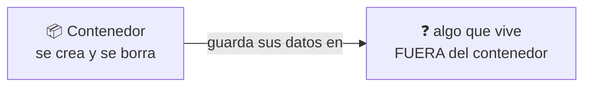
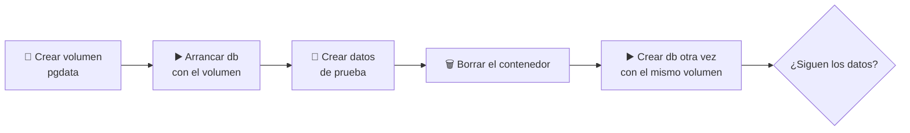

# 🐳 Docker · D06 (modo socrático): Persistencia de datos

> 📅 Martes 20 de octubre de 2026 · ⏱️ 60 min

## 📮 Plantilla de respuestas (lo primero)

> Cópiala **ahora** y ve rellenándola mientras haces la sesión. Cuando termines, o cuando quieras que corrija un tramo, pégala en el chat. Si no sabes algo, escribe `no sé`: es útil para mí.

```text
══════════ CUESTIONARIO D05 ══════════
1:      2:      3:      4:
5 (V/F + motivo en una frase):
6:      7:
8 (comando completo):

══════════ PARTE 1 · LO EFÍMERO ══════════
1.1 Predicción tras parar y arrancar (¿sigue el archivo?):
1.1 Predicción tras borrar y crear otro (¿sigue?):
1.1 Resultado real y explicación con las capas de D02:
1.2 Problema al actualizar la imagen:
1.3 Dos características de ese «algo» de fuera:
    a)
    b)

══════════ PARTE 2 · VOLÚMENES ══════════
2.1 Mountpoint que veo:
2.1 ¿Quién gestiona esa carpeta y por qué?:
2.2 Lo que pongo en el ❓ del -v:
2.2 Predicción (¿v2 ve nota.txt?):
2.2 Resultado real:
2.3 Izquierda de «:» =          Derecha de «:» =
2.3 Si pongo una ruta de mi ordenador, cambia que:
2.4 Destination de Postgres:
2.5 Predicción 1 (volume rm con un contenedor parado):
2.5 Predicción 2 (--rm borra el volumen con nombre):
2.5 Resultado real y conclusión (¿quién es el dueño de los datos?):
2.6 Por defecto borra:
2.6 Para borrar también los que tienen nombre:
2.6 Por qué hay que tener cuidado:

══════════ PARTE 3 · BIND MOUNTS ══════════
3.1 Predicción:
3.1 Resultado y diferencia entre "$PWD" y datos:
3.2 Lo que pongo en el ❓ del -p:
3.2 Predicción (¿hay que reiniciar?):
3.2 Resultado y lo que me dice:
3.3 Predicción:
3.3 Resultado y para qué sirve :ro:
3.4 Propietario del archivo:
3.4 Por qué:

══════════ PARTE 4 · ¿CUÁL USO? ══════════
4.1 Tabla
                      Capa efímera | Volumen | Bind mount | tmpfs
  ¿Quién gestiona?:
  ¿Dónde vive?:
  ¿Sobrevive al borrar?:
  ¿Lo veo en mi carpeta?:
4.2 (elección + motivo)
  a)
  b)
  c)
  d)
  e)
  f)

══════════ PARTE 5 · PRÁCTICA CON POSTGRES ══════════
Paso 2 comando completo:
Paso 4 predicción (¿sigue tareas? ¿por qué?):
Paso 4 resultado:
Paso 5 volúmenes que veo y qué significaría uno extra de nombre largo:
Paso 6 por qué primero el contenedor y después el volumen:
Reto (comandos y lo que muestra el segundo contenedor):

══════════ CIERRE ══════════
Reflexión (3 frases):
Confianza 1-5:  efímero _   volumen _   bind mount _   elegir _
```

---

**🎯 Objetivo:** descubrir por qué los datos de un contenedor desaparecen y cómo guardarlos con **volúmenes** y **bind mounts**. Solo Docker: aquí no hay nada de SQL ni de programar. Preguntas, pistas y experimentos; la terminal es el juez.

| Icono | Significa |
| :---: | :--- |
| 🤔 | **Pregunta** para pensar |
| ✍️ | **Escribe tu respuesta** antes de seguir |
| 💡 | **Pista**: ábrelas una a una, solo si te atascas |
| 🧪 | **Experimento**: predice, ejecuta y compara |
| 🎯 | **Reto** |

> [!IMPORTANT]
> **Regla de oro:** primero predice, después ejecuta. No busques la respuesta antes de escribir la tuya.

| ⏱️ Tiempo | 📚 Bloque |
| :---: | :--- |
| 8 min | 📝 Calentamiento: cuestionario de D05 |
| 8 min | 🫧 Parte 1: lo efímero |
| 14 min | 💾 Parte 2: volúmenes |
| 12 min | 📂 Parte 3: bind mounts |
| 6 min | ⚖️ Parte 4: ¿cuál uso? |
| 12 min | 🛠️ Parte 5: práctica con Postgres |

### 📊 Mi progreso

- [ ] Calentamiento D05
- [ ] Parte 1: lo efímero
- [ ] Parte 2: volúmenes
- [ ] Parte 3: bind mounts
- [ ] Parte 4: ¿cuál uso?
- [ ] Parte 5: práctica
- [ ] Respuestas enviadas

---

## 📝 Calentamiento: ¿qué recuerdas de D05? `8 min`

Contesta **sin mirar los apuntes**. Después me envías tus respuestas y te diré en qué te has equivocado y por qué.

### 1️⃣ Fijar la versión

Quieres que tu base de datos se comporte igual dentro de seis meses. ¿Qué imagen escribes?

- **A)** `postgres`
- **B)** `postgres:latest`
- **C)** `postgres:17`
- **D)** `postgres:alpine`

### 2️⃣ Sin contraseña

Arrancas `postgres` **sin** la variable `POSTGRES_PASSWORD`. ¿Qué ocurre?

- **A)** Arranca y te pide la contraseña después
- **B)** El contenedor se para solo y el motivo se ve en `docker logs`
- **C)** Arranca con una contraseña por defecto
- **D)** `docker run` rechaza el comando y no crea nada

### 3️⃣ Los puertos

Ejecutas `docker run -d -p 5433:5432 ...` con Postgres. ¿A qué puerto te conectas **desde tu ordenador**?

- **A)** 5432
- **B)** 5433
- **C)** 80
- **D)** A ninguno, no se puede

### 4️⃣ Sin publicar puerto

No has usado `-p`. ¿Qué forma de conectarte a la base de datos **sigue funcionando**?

- **A)** `psql -h localhost` desde tu ordenador
- **B)** `docker exec -it db psql -U postgres`
- **C)** Abrir `localhost:5432` en el navegador
- **D)** Ninguna

### 5️⃣ Verdadero o falso

> «Si creo un contenedor con `--rm`, cuando se pare ya no podré leer sus `docker logs`».

✍️ Responde **Verdadero** o **Falso** y justifícalo en una frase.

### 6️⃣ Capas que ya existían

Al descargar una imagen, una capa aparece como `Already exists` aunque es la primera vez que bajas esa imagen. ¿Por qué?

- **A)** Dos imágenes pueden compartir capas y Docker no las descarga dos veces
- **B)** Docker la descargó dos veces por error
- **C)** Es un fallo de la descarga
- **D)** Docker la tomó de la caché del navegador

### 7️⃣ Un volumen que no creaste

No has usado `-v`, pero `docker volume ls` muestra un volumen con un nombre largo y raro. ¿Por qué?

- **A)** La imagen declara una carpeta de datos y Docker crea un volumen anónimo para ella
- **B)** Docker crea siempre un volumen por cada contenedor
- **C)** Lo creó tu terminal
- **D)** Es un error de Docker

### 8️⃣ Tu comando

✍️ Escribe **un comando completo** para arrancar Postgres 17 con nombre `db`, contraseña `abc`, accesible desde tu ordenador en el puerto 5432 y en segundo plano.

---

## 🫧 Parte 1: lo efímero `8 min`

### 🧪 1.1 Predice antes de ejecutar

Vas a crear un contenedor, escribir un archivo dentro, pararlo, arrancarlo y, al final, borrarlo y crear otro igual.

✍️ **Predice las dos respuestas:**
1. Después de **parar y volver a arrancar** el mismo contenedor, ¿sigue el archivo?
2. Después de **borrarlo y crear otro** con el mismo comando, ¿sigue?

Ahora ejecútalo:

```bash
docker run -d --name efimero alpine sleep 3600
docker exec efimero sh -c "echo hola > /nota.txt"
docker exec efimero cat /nota.txt
docker stop efimero
docker start efimero
docker exec efimero cat /nota.txt
docker rm -f efimero
docker run -d --name efimero alpine sleep 3600
docker exec efimero cat /nota.txt
```

✍️ ¿Coinciden tus predicciones con lo que ha pasado? Explícalo con lo que viste en **D02 sobre capas**.

<details>
<summary>💡 Pista 1</summary>

En D02 viste que cada contenedor añade una capa propia encima de la imagen. ¿Dónde se escribió `nota.txt`?

</details>

<details>
<summary>💡 Pista 2</summary>

¿Esa capa pertenece a la **imagen** o al **contenedor**? ¿Qué le pasa al contenedor cuando haces `docker rm`?

</details>

### 🤔 1.2 El problema

Una base de datos guarda todo en archivos. ✍️ Si esos archivos quedan en la capa de escritura del contenedor, ¿qué problema aparece el día que quieras **actualizar la imagen**?

### 🤔 1.3 Imagina la solución



✍️ ¿Qué características tendría que tener ese «algo» para que el problema de 1.2 desaparezca? Escribe **dos**.

---

## 💾 Parte 2: volúmenes `14 min`

### 🧪 2.1 Crea uno y mira dentro

```bash
docker volume create datos
docker volume inspect datos
```

✍️ **Responde:**
1. En la salida, busca `Mountpoint`. ¿Qué ruta aparece?
2. ¿Quién crees que gestiona esa carpeta: tú o Docker? ¿Por qué?

### 🎯 2.2 Complétalo tú

Quieres repetir el experimento de 1.1 pero guardando la nota en el volumen `datos`, montado dentro del contenedor en `/data`.

```text
docker run -d --name v1 ❓ alpine sleep 3600
```

✍️ ¿Qué pones en el ❓? Después **predice** qué ocurrirá con este plan:

1. Escribes `/data/nota.txt` dentro de `v1`.
2. Borras `v1` con `docker rm -f v1`.
3. Creas `v2` con **el mismo ❓** y lees `/data/nota.txt`.

<details>
<summary>💡 Pista 1</summary>

En D04 viste la forma `-v nombre:ruta`.

</details>

<details>
<summary>💡 Pista 2</summary>

El nombre es el del volumen que acabas de crear. La ruta es la carpeta **dentro del contenedor**.

</details>

Verifica:

```bash
docker exec v1 sh -c "echo hola > /data/nota.txt"
docker rm -f v1
docker run -d --name v2 ❓ alpine sleep 3600
docker exec v2 cat /data/nota.txt
```

✍️ ¿Qué ha pasado? ¿Acertaste?

### 🤔 2.3 Mirando el `-v`

```text
-v   datos : /data
      │       │
     ❓      ❓
```

✍️ ¿Qué es cada lado de los dos puntos? Y una pregunta más: si en lugar de `datos` escribieras una **ruta de tu ordenador**, como `/home/ana/datos`, ¿qué crees que cambiaría? Guarda esa idea para la Parte 3.

### 🧪 2.4 ¿Dónde guarda Postgres sus datos?

Para montar un volumen en Postgres necesitas saber **qué carpeta** usa dentro del contenedor. No hace falta memorizarla: se consulta.

Arranca uno de prueba y mira sus montajes:

```bash
docker run -d --name pgprueba -e POSTGRES_PASSWORD=123456 postgres:17
docker inspect --format '{{json .Mounts}}' pgprueba
docker rm -f pgprueba
```

✍️ ¿Qué ruta aparece en `Destination`?

> [!NOTE]
> Esta ruta puede cambiar entre versiones mayores de la imagen. Por eso se consulta con `inspect` y no se copia de memoria. Ya hiciste algo parecido en D05, en el ejercicio 2.6.

### 🧪 2.5 ¿Quién borra un volumen?

✍️ **Predice:**
1. Tienes un contenedor, aunque esté **parado**, que usa el volumen `datos`. Ejecutas `docker volume rm datos`. ¿Qué pasa?
2. Creas un contenedor con `--rm` y con `-v datos:/data`. Cuando se pare, ¿se borra también el volumen `datos`?

Verifica:

```bash
docker volume rm datos
docker run --rm -v datos:/data alpine ls /data
docker volume ls
```

✍️ ¿Qué te dicen los resultados sobre quién es el dueño de los datos: el contenedor o el volumen?

### 🧪 2.6 El comando peligroso

```bash
docker volume prune --help
```

✍️ **Lee la ayuda y responde:**
1. ¿Qué volúmenes borra **por defecto**?
2. ¿Qué tendrías que añadir para que borre **también** los que tienen nombre?
3. ¿Por qué es un comando que hay que usar con cuidado?

---

## 📂 Parte 3: bind mounts `12 min`

### 🧪 3.1 Tu carpeta dentro del contenedor

Esto recoge la idea que guardaste en 2.3.

✍️ **Predice:** ¿qué mostrará este comando?

```bash
docker run --rm -v "$PWD":/app alpine ls /app
```

Ejecútalo en una carpeta que tenga algunos archivos y compara.

✍️ ¿Qué significa `"$PWD"`? ¿Qué diferencia hay con el `datos` de antes?

### 🎯 3.2 Edita tu web sin reiniciar nada

Crea una carpeta con un archivo `index.html`:

```bash
mkdir -p ~/web-d06 && cd ~/web-d06
echo "<h1>Hola desde mi carpeta</h1>" > index.html
```

Completa el comando para servir esa carpeta con nginx y verla en `http://localhost:8080`:

```text
docker run -d --name web -p ❓ -v "$PWD":/usr/share/nginx/html:ro nginx:alpine
```

✍️ ¿Qué pones en el ❓?

<details>
<summary>💡 Pista</summary>

Formato `puerto-de-tu-ordenador:puerto-del-contenedor`. nginx escucha por dentro en el puerto 80.

</details>

Ahora piensa:

✍️ **Predice:** si cambias el texto de `index.html` y recargas la página, ¿tienes que reiniciar el contenedor?

```bash
echo "<h1>Cambiado sin reiniciar</h1>" > index.html
```

✍️ ¿Qué ha pasado? ¿Qué te dice sobre dónde viven realmente esos archivos?

### 🧪 3.3 El `:ro`

Has puesto `:ro` al final del montaje.

✍️ **Predice** qué ocurrirá con esto:

```bash
docker exec web sh -c "echo x > /usr/share/nginx/html/nuevo.txt"
```

Ejecútalo y compara. ✍️ ¿Para qué te sirve `:ro`?

### 🧪 3.4 ¿De quién son los archivos?

```bash
docker run --rm -v "$PWD":/data alpine touch /data/creado-por-docker.txt
ls -l creado-por-docker.txt
```

✍️ **Responde:**
1. ¿Quién es el propietario del archivo en tu ordenador?
2. ¿Por qué crees que es ese usuario y no tú?

<details>
<summary>💡 Pista</summary>

Mira con qué usuario se ejecuta el proceso dentro de un contenedor si no se lo indicas. También puedes explorar `docker run --help` buscando la palabra *user*.

</details>

Cuando acabes: `docker rm -f web`.

---

## ⚖️ Parte 4: ¿cuál uso? `6 min`

Hay una tercera opción que no hemos usado: **tmpfs**. Guarda los datos **en la memoria RAM** y desaparecen cuando el contenedor se para. Se crea con `--tmpfs /ruta`.

### 🎯 4.1 Completa la tabla con lo que has descubierto

| | 🫧 Capa efímera | 💾 Volumen | 📂 Bind mount | ⚡ tmpfs |
| :--- | :---: | :---: | :---: | :---: |
| **¿Quién lo gestiona?** | ❓ | ❓ | ❓ | ❓ |
| **¿Dónde vive?** | ❓ | ❓ | ❓ | ❓ |
| **¿Sobrevive a borrar el contenedor?** | ❓ | ❓ | ❓ | ❓ |
| **¿Lo veo desde mi carpeta?** | ❓ | ❓ | ❓ | ❓ |

### 🎯 4.2 Elige para cada caso

✍️ Para cada situación, elige **capa efímera**, **volumen**, **bind mount** o **tmpfs**, y escribe **por qué**:

| Caso | Tu elección y motivo |
| :--- | :--- |
| a) Los datos de una base de datos importante | ❓ |
| b) El código que estás editando mientras desarrollas | ❓ |
| c) Un archivo de configuración que el contenedor solo debe leer | ❓ |
| d) Una caché temporal que no debe llegar nunca al disco | ❓ |
| e) Una copia de seguridad que quieres abrir desde tu carpeta | ❓ |
| f) Datos de una prueba que no te importa perder | ❓ |

---

## 🛠️ Parte 5: práctica con Postgres `12 min`

**Objetivo:** demostrar que los datos de una base de datos **sobreviven** a borrar su contenedor.



### Paso 1 · el volumen

```bash
docker volume create pgdata
```

### Paso 2 · arranca Postgres con el volumen

Completa **tú** el montaje. Usa la ruta que descubriste en 2.4:

```text
docker run -d --name db -e POSTGRES_PASSWORD=123456 -v ❓:❓ postgres:17
```

✍️ Escribe el comando completo que has usado.

<details>
<summary>💡 Pista 1</summary>

A la izquierda del `:` va el nombre del volumen. A la derecha, la ruta **dentro del contenedor**.

</details>

<details>
<summary>💡 Pista 2</summary>

Si la ruta no coincide con la que usa Postgres, tus datos irán a **otro sitio** y no se conservarán.

</details>

### Paso 3 · datos de prueba

Copia y pega tal cual:

```bash
docker exec db psql -U postgres -c "CREATE TABLE tareas (id int);"
docker exec db psql -U postgres -c "\dt"
```

### Paso 4 · predice y comprueba

✍️ **Predice:** voy a ejecutar `docker rm -f db`, crear el contenedor **otra vez con el mismo comando** del Paso 2 y listar las tablas. ¿Seguirá `tareas`? ¿Por qué?

Compruébalo:

```bash
docker rm -f db
docker run -d --name db -e POSTGRES_PASSWORD=123456 -v ❓:❓ postgres:17
docker exec db psql -U postgres -c "\dt"
```

### Paso 5 · ¿qué volúmenes tengo?

```bash
docker volume ls
```

✍️ **Responde:**
1. ¿Cuántos volúmenes ves y cómo se llaman?
2. Si vieras uno con nombre largo y raro además de `pgdata`, ¿qué te estaría diciendo?

### Paso 6 · limpia

```bash
docker rm -f db
docker volume rm pgdata
```

✍️ ¿Por qué hay que borrar **primero** el contenedor y **después** el volumen?

### 🎯 Reto: dos contenedores, un volumen

Haz que **un contenedor escriba** un archivo en un volumen y que **otro contenedor, a la vez**, lo lea. Los dos tienen que estar en marcha al mismo tiempo.

✍️ Pégame los comandos que has usado y lo que ha mostrado el segundo contenedor.

---

## 🤔 Reflexión

✍️ En **tres frases**, explícale a un compañero cuándo usarías un **volumen** y cuándo un **bind mount**.

### 📈 ¿Qué tal me ha ido?

Puntúa tu seguridad de **1** (nada) a **5** (podría enseñarlo):

| Tema | 1 | 2 | 3 | 4 | 5 |
| :--- | :-: | :-: | :-: | :-: | :-: |
| Por qué los datos del contenedor son efímeros | ☐ | ☐ | ☐ | ☐ | ☐ |
| Crear y usar un volumen | ☐ | ☐ | ☐ | ☐ | ☐ |
| Montar una carpeta de mi ordenador | ☐ | ☐ | ☐ | ☐ | ☐ |
| Elegir entre volumen y bind mount | ☐ | ☐ | ☐ | ☐ | ☐ |

---

## 📮 Entrega

Pega en el chat la **plantilla del principio** con lo que lleves relleno. Corregiré el cuestionario y lo que hayas hecho, y te diré en qué te has equivocado y por qué.

---

➡️ **Siguiente sesión, D07:** Dockerfiles. Hasta ahora has usado imágenes de otros; en D07 harás la tuya.