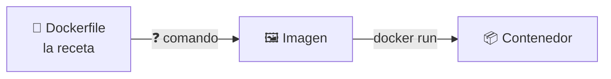
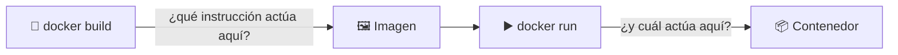
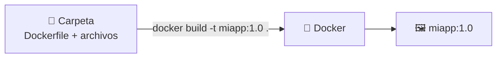
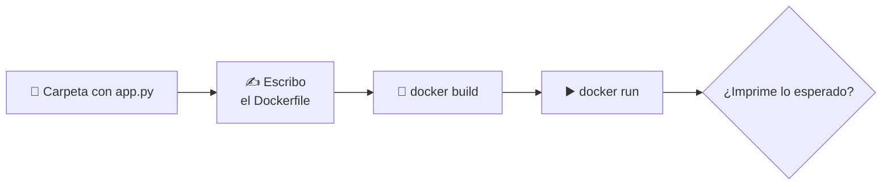

# 🐳 Docker · D07 (modo socrático): Dockerfiles

> 📅 Miércoles 21 de octubre de 2026 · ⏱️ 60 min

## 📮 Plantilla de respuestas (lo primero)

> Cópiala **ahora** y ve rellenándola mientras haces la sesión. Cuando termines, o cuando quieras que corrija un tramo, pégala en el chat. Si no sabes algo, escribe `no sé`: es útil para mí.

```text
══════════ CUESTIONARIO D06 ══════════
1:      2:      3:      4:
5 (V/F + motivo en una frase):
6:      7:
8 (comando completo):
8 (cómo averiguo la ruta de datos):

══════════ PARTE 1 · QUÉ ES UN DOCKERFILE ══════════
1.1 Tres cosas que hay que decirle a Docker:
    a)
    b)
    c)
1.2 Comando que va en el ❓ del diagrama:
1.3 Qué hace cada línea:
    FROM nginx:alpine =
    COPY index.html ... =
    EXPOSE 80 =

══════════ PARTE 2 · LAS INSTRUCCIONES ══════════
2.1 Predicción (¿cuál pesa menos y cuánto aprox.?):
2.1 Tamaños reales y conclusión:
2.2 Predicción de los dos pwd:
2.2 Resultado real:
2.2 Instrucción del Dockerfile que equivale a -w:
2.3 ¿De dónde sale el origen de un COPY?:
2.3 Resultado de ls /app:
2.4 Predicción (¿cuándo aparece cada mensaje?):
2.4 Resultado en el build:
2.4 Resultado en dos docker run seguidos:
2.4 Conclusión (RUN = ...   CMD = ...):
2.5 Predicción de docker run --rm ruc echo otro:
2.5 Resultado y conclusión:
2.6 Predicción (¿docker port w1 muestra algo?):
2.6 Resultado sin -p y con -p:
2.6 Qué hace realmente EXPOSE:

══════════ PARTE 3 · CONSTRUIR ══════════
3.1 Qué significa -t:
3.1 Qué significa el «.» del final:
3.1 Predicción y mensaje de error en una carpeta sin Dockerfile:
3.2 Instrucciones mías que reconozco en docker image history:
3.2 Cuál pesa más y por qué:

══════════ PARTE 4 · PRÁCTICA: MI PRIMERA IMAGEN ══════════
Paso 2 Dockerfile completo:
Paso 3 predicción del build:
Paso 3 resultado real:
Paso 4 predicción de docker run --rm miapp:1.0:
Paso 4 resultado real:
Paso 5 Dockerfile con ENV (línea añadida y dónde):
Paso 5 predicción sin -e:
Paso 5 predicción con -e VERSION=2.0 (¿gana ENV o -e?):
Paso 5 resultado real y conclusión:
Paso 6 tamaño de la imagen y capas que reconozco:
Paso 7 predicción (qué error y en qué instrucción):
Paso 7 resultado real:
Reto (comando y lo que imprime):

══════════ CIERRE ══════════
Reflexión (3 frases):
Confianza 1-5:  qué es un Dockerfile _   instrucciones _   RUN vs CMD _   build _
```

---

**🎯 Objetivo:** pasar de usar imágenes de otros a **construir la tuya** con un Dockerfile. Solo Docker: el código de ejemplo te lo doy hecho y tú solo escribes el Dockerfile. Preguntas, pistas y experimentos; la terminal es el juez.

| Icono | Significa |
| :---: | :--- |
| 🤔 | **Pregunta** para pensar |
| ✍️ | **Escribe tu respuesta** antes de seguir |
| 💡 | **Pista**: ábrelas una a una, solo si te atascas |
| 🧪 | **Experimento**: predice, ejecuta y compara |
| 🎯 | **Reto** |

> [!IMPORTANT]
> **Regla de oro:** primero predice, después ejecuta. No busques la respuesta antes de escribir la tuya.

| ⏱️ Tiempo | 📚 Bloque |
| :---: | :--- |
| 8 min | 📝 Calentamiento: cuestionario de D06 |
| 6 min | 📄 Parte 1: qué es un Dockerfile |
| 18 min | 🧱 Parte 2: las instrucciones |
| 8 min | 🔨 Parte 3: construir |
| 20 min | 🛠️ Parte 4: práctica |

### 📊 Mi progreso

- [ ] Calentamiento D06
- [ ] Parte 1: qué es un Dockerfile
- [ ] Parte 2: las instrucciones
- [ ] Parte 3: construir
- [ ] Parte 4: práctica
- [ ] Respuestas enviadas

---

## 📝 Calentamiento: ¿qué recuerdas de D06? `8 min`

Contesta **sin mirar los apuntes**. Si todavía no has hecho D06, escribe `no sé` donde corresponda: me sirve igual para saber por dónde empezar.

### 1️⃣ Parar y arrancar

Creas un contenedor, escribes un archivo dentro (sin usar volúmenes), ejecutas `docker stop` y luego `docker start` sobre el mismo contenedor. ¿Sigue el archivo?

- **A)** Sí
- **B)** No, se borra al parar
- **C)** Solo si lo creaste con `-it`
- **D)** Depende de la imagen

### 2️⃣ Borrar y crear otro

Ahora ejecutas `docker rm -f` y creas otro contenedor igual. ¿Y el archivo?

- **A)** Sigue ahí
- **B)** Ha desaparecido
- **C)** Depende del sistema operativo
- **D)** Se copia solo al contenedor nuevo

### 3️⃣ Un volumen

En `-v datos:/data`, ¿qué es `datos`?

- **A)** Una carpeta de tu ordenador
- **B)** El nombre de un volumen que gestiona Docker
- **C)** El nombre del contenedor
- **D)** El nombre de la imagen

### 4️⃣ Tipo de montaje

¿Qué tipo de montaje es `-v "$PWD":/app`?

- **A)** Un volumen
- **B)** Un bind mount
- **C)** Un tmpfs
- **D)** La capa efímera

### 5️⃣ Verdadero o falso

> «`docker volume rm datos` borra el volumen aunque haya un contenedor **parado** que lo usa».

✍️ Responde **Verdadero** o **Falso** y justifícalo en una frase.

### 6️⃣ El `:ro`

¿Qué efecto tiene `:ro` al final de un montaje?

- **A)** El contenedor no puede escribir en esa carpeta
- **B)** Tu ordenador no puede escribir en esa carpeta
- **C)** Comprime los archivos
- **D)** Reinicia el contenedor al cambiar un archivo

### 7️⃣ Editar sin reconstruir

Quieres editar tu código en tu ordenador y ver los cambios dentro del contenedor al momento. ¿Qué usas?

- **A)** Un volumen con nombre
- **B)** Un bind mount
- **C)** Un tmpfs
- **D)** La capa efímera

### 8️⃣ Tu comando

✍️ Escribe **un comando completo** para arrancar Postgres 17 con nombre `db`, contraseña `abc`, guardando sus datos en el volumen `pgdata`. Y explica **cómo averiguas la ruta** donde Postgres guarda sus datos.

---

## 📄 Parte 1: qué es un Dockerfile `6 min`

### 🤔 1.1 Piensa en la receta

Hasta ahora has usado imágenes que hicieron otros. Ahora vas a **construir la tuya**.

✍️ ¿Qué **tres cosas** crees que hay que decirle a Docker para que construya una imagen de una aplicación?

<details>
<summary>💡 Pista 1</summary>

Cuando arrancas un contenedor, ¿de dónde sale el sistema que hay dentro? ¿Y tus archivos?

</details>

<details>
<summary>💡 Pista 2</summary>

Piensa en lo que pasa **al encender el contenedor**: ¿qué programa se ejecuta?

</details>

### 🤔 1.2 El camino completo

Un **Dockerfile** es un archivo de texto con la receta de la imagen.



✍️ ¿Qué comando va en el ❓?

### 🤔 1.3 Léelo antes de que te lo explique

Este Dockerfile sirve una web. **Nadie te ha dicho** qué significa cada línea.

```dockerfile
FROM nginx:alpine
COPY index.html /usr/share/nginx/html/index.html
EXPOSE 80
```

✍️ Con lo que sabes de D04, D05 y D06, **¿qué crees que hace cada línea?** Escribe tu hipótesis.

<details>
<summary>💡 Pista 1</summary>

La primera línea tiene el mismo formato que las imágenes que ya usas: `nombre:etiqueta`.

</details>

<details>
<summary>💡 Pista 2</summary>

En la segunda, la **primera** ruta es de tu carpeta y la **segunda** es de dentro de la imagen. Mira en D06 cómo se llamaba la carpeta donde nginx sirve sus páginas.

</details>

---

## 🧱 Parte 2: las instrucciones `18 min`

### 🧪 2.1 `FROM`: elegir el punto de partida

```bash
docker pull python:3.12
docker pull python:3.12-slim
docker image ls python
```

✍️ **Antes de ejecutar, predice:** ¿cuál pesará menos y **más o menos cuántas veces menos**?

Después: ✍️ ¿Qué te dice eso sobre la importancia del `FROM` que elijas?

### 🧪 2.2 `WORKDIR`: la carpeta de trabajo

```bash
docker run --rm python:3.12-slim pwd
docker run --rm -w /app python:3.12-slim pwd
```

✍️ **Predice** qué imprimirá cada comando. Después ejecútalos.

✍️ ¿Qué instrucción de un Dockerfile crees que hace lo mismo que la opción `-w`? Ya la usaste en D05.

### 🧪 2.3 `COPY`: de dónde salen los archivos

En `COPY origen destino`, el **origen** no puede ser cualquier sitio de tu ordenador.

✍️ **Responde:** ¿de dónde crees que sale? Piensa en qué carpeta le pasas a `docker build` (la verás en la Parte 3).

Compruébalo con este Dockerfile de prueba. Copia y pega tal cual:

```bash
mkdir -p ~/d07-copy && cd ~/d07-copy
echo "hola" > saludo.txt
cat > Dockerfile <<'EOF'
FROM alpine
WORKDIR /app
COPY saludo.txt .
EOF
docker build -t copia:1 .
docker run --rm copia:1 ls /app
```

✍️ ¿Qué muestra el último comando? ¿Qué hizo cada instrucción?

### 🧪 2.4 `RUN` frente a `CMD`

Esta es la distinción **más importante** de la sesión.



Copia y pega este Dockerfile:

```bash
mkdir -p ~/d07-runcmd && cd ~/d07-runcmd
cat > Dockerfile <<'EOF'
FROM alpine
RUN echo "estoy construyendo la imagen"
CMD ["echo", "estoy ejecutando el contenedor"]
EOF
```

✍️ **Predice:** de los dos mensajes, ¿cuál se verá al **construir** la imagen y cuál al **ejecutar** el contenedor? ¿Y si ejecutas el contenedor **dos veces**?

Ahora compruébalo:

```bash
docker build --progress=plain --no-cache -t ruc .
docker run --rm ruc
docker run --rm ruc
```

✍️ ¿Coincide? Completa con tus palabras: **RUN** se ejecuta cuando ______ y **CMD** se ejecuta cuando ______.

<details>
<summary>💡 Pista</summary>

Cuenta cuántas veces aparece cada mensaje en todo lo que has ejecutado.

</details>

### 🧪 2.5 ¿Se puede cambiar el `CMD`?

✍️ **Predice** qué imprimirá esto:

```bash
docker run --rm ruc echo otro
```

Ejecútalo. ✍️ ¿Qué ha pasado con el `CMD` del Dockerfile? ¿Qué te dice sobre su carácter «por defecto»?

### 🧪 2.6 `EXPOSE`: ¿publica el puerto?

Construye la web de 1.3:

```bash
mkdir -p ~/d07-web && cd ~/d07-web
echo "<h1>Hola desde mi imagen</h1>" > index.html
cat > Dockerfile <<'EOF'
FROM nginx:alpine
COPY index.html /usr/share/nginx/html/index.html
EXPOSE 80
EOF
docker build -t web-d07 .
```

✍️ **Predice:** si ejecutas la imagen **sin** `-p`, ¿mostrará algo `docker port w1`?

```bash
docker run -d --name w1 web-d07
docker port w1
docker rm -f w1
docker run -d --name w1 -p 8080:80 web-d07
docker port w1
docker rm -f w1
```

✍️ **Responde:**
1. ¿Qué ha mostrado cada `docker port`?
2. Entonces, ¿qué hace realmente `EXPOSE 80`? ¿Y qué hace `-p`?

---

## 🔨 Parte 3: construir `8 min`

### 🤔 3.1 Anatomía del `docker build`

```text
docker build  -t miapp:1.0  .
                  │          │
                 ❓         ❓
```



✍️ ¿Qué crees que significan `-t` y el **punto** final? Pista visual: mira el diagrama.

<details>
<summary>💡 Pista</summary>

En las imágenes que usas, el nombre y la etiqueta van separados por `:`. ¿Y qué es «el sitio» desde donde Docker lee tus archivos?

</details>

🧪 **Prueba:** ¿qué pasaría si ejecutas `docker build` en una carpeta **sin** Dockerfile? Predice y comprueba:

```bash
mkdir -p ~/d07-vacia && cd ~/d07-vacia
docker build -t x .
```

✍️ ¿Qué mensaje de error ves?

### 🧪 3.2 Las capas de tu imagen

Recuerda D02: una imagen son capas.

```bash
docker image history copia:1
```

✍️ **Responde:**
1. ¿Reconoces en la columna `CREATED BY` las instrucciones de tu Dockerfile? ¿Cuáles?
2. En la columna `SIZE`, ¿cuál de tus instrucciones tiene más peso? ¿Por qué crees que es esa?

---

## 🛠️ Parte 4: práctica, mi primera imagen `20 min`

**Objetivo:** empaquetar una aplicación en una imagen tuya y comprobar que funciona.



### Paso 1 · prepara la aplicación

El código **te lo doy hecho**: no hay que entenderlo ni modificarlo. Es un programa de dos líneas que saluda y muestra una variable llamada `VERSION`.

```bash
mkdir -p ~/d07 && cd ~/d07
cat > app.py <<'EOF'
import os
print("Hola desde mi primera imagen")
print("Version:", os.environ.get("VERSION", "sin definir"))
EOF
```

### Paso 2 · escribe tu Dockerfile

Crea un archivo llamado `Dockerfile` en esa carpeta. Tiene que:

1. Partir de **Python 3.12 en su variante ligera**.
2. Trabajar en la carpeta `/app`.
3. Copiar `app.py` dentro de la imagen.
4. Ejecutar `app.py` con Python cuando arranque el contenedor.

✍️ Escribe tu Dockerfile completo.

<details>
<summary>💡 Pista 1</summary>

Cuatro requisitos, **cuatro instrucciones**. Cada una responde a una pregunta: ¿de dónde parto?, ¿dónde trabajo?, ¿qué copio?, ¿qué ejecuto al arrancar?

</details>

<details>
<summary>💡 Pista 2</summary>

Los nombres son `FROM`, `WORKDIR`, `COPY` y `CMD`. En `CMD` el comando va como una **lista entre corchetes y comillas dobles**, igual que en el Dockerfile de 2.4.

</details>

### Paso 3 · construye

```bash
docker build -t miapp:1.0 .
```

✍️ **Antes, predice:** ¿cuántos «pasos» (uno por instrucción) crees que verás en la salida? Después, ✍️ cuéntame qué has visto.

### Paso 4 · ejecuta

✍️ **Predice** qué imprimirá y después ejecuta:

```bash
docker run --rm miapp:1.0
```

### Paso 5 · añade una variable de entorno

Quieres que el programa muestre `Version: 1.0` **sin tocar `app.py`**.

✍️ **Responde:**
1. ¿Qué instrucción añadirías a tu Dockerfile y **dónde**?
2. **Predice** qué imprimirá al reconstruir y ejecutar.
3. Luego ejecuta con `-e VERSION=2.0`. **Predice:** ¿gana el valor del Dockerfile o el de `-e`?

```bash
docker build -t miapp:1.0 .
docker run --rm miapp:1.0
docker run --rm -e VERSION=2.0 miapp:1.0
```

<details>
<summary>💡 Pista</summary>

La instrucción tiene el mismo nombre que el tipo de cosa que pasas con `-e`: **variable de entorno**, en inglés *environment*.

</details>

### Paso 6 · mira lo que has construido

```bash
docker image ls miapp
docker image history miapp:1.0
```

✍️ ¿Cuánto pesa tu imagen? ¿Qué instrucciones reconoces en el historial?

### Paso 7 · rompe algo a propósito

Aprender a leer errores vale tanto como acertar.

```bash
mv app.py app.bak
docker build -t miapp:1.0 .
mv app.bak app.py
```

✍️ **Predice:** ¿qué error saldrá y **en qué instrucción** fallará? Después compáralo con lo que ves.

<details>
<summary>💡 Pista</summary>

Recuerda de dónde saca los archivos el `COPY`: de la carpeta del build.

</details>

### 🎯 Reto: otro comando, la misma imagen

Haz que **la misma imagen `miapp:1.0`** muestre la versión de Python **sin modificar el Dockerfile ni reconstruirla**.

✍️ Escribe el comando y qué imprime.

<details>
<summary>💡 Pista</summary>

Lo que descubriste en 2.5 sobre el `CMD`.

</details>

---

## 🤔 Reflexión

✍️ En **tres frases**, explícale a un compañero la diferencia entre `RUN` y `CMD` y cuándo se ejecuta cada una.

### 📈 ¿Qué tal me ha ido?

Puntúa tu seguridad de **1** (nada) a **5** (podría enseñarlo):

| Tema | 1 | 2 | 3 | 4 | 5 |
| :--- | :-: | :-: | :-: | :-: | :-: |
| Qué es un Dockerfile y qué hace `docker build` | ☐ | ☐ | ☐ | ☐ | ☐ |
| `FROM`, `WORKDIR`, `COPY` | ☐ | ☐ | ☐ | ☐ | ☐ |
| Diferencia entre `RUN` y `CMD` | ☐ | ☐ | ☐ | ☐ | ☐ |
| Construir y ejecutar mi propia imagen | ☐ | ☐ | ☐ | ☐ | ☐ |

---

## 📮 Entrega

Pega en el chat la **plantilla del principio** con lo que lleves relleno. Corregiré el cuestionario y lo que hayas hecho, y te diré en qué te has equivocado y por qué.

---

➡️ **Siguiente sesión, D08:** optimización de imágenes (caché de capas, tamaño y multi-stage). Partirás de la imagen que acabas de construir.