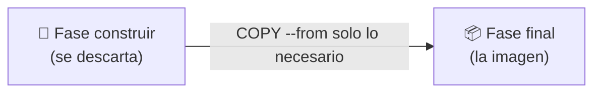

# 🐳 Docker · D08 (modo socrático): optimización de imágenes

> 📅 Jueves 22 de octubre de 2026 · ⏱️ 45 min

## 📮 Plantilla de respuestas (lo primero)

> Cópiala **ahora** y ve rellenándola. Cuando termines, o quieras que corrija un tramo, pégala en el chat. Si no sabes algo, escribe `no sé`.

```text
══════════ CUESTIONARIO D07 ══════════
1:      2:      3 (V/F + motivo):      4:      5:
6 (Dockerfile completo):
7 (STATUS y por qué):

══════════ PARTE 1 · CAPAS Y CACHÉ ══════════
1.1 Predicción (segundo build):
1.1 Resultado real:
1.2 Predicción (qué pasos se rehacen tras cambiar app.py):
1.2 Resultado real:
1.3 Por qué se rehace pip aunque requirements no cambió:
1.4 Mi Dockerfile v2 completo:
1.4 Predicción tras cambiar app.py otra vez:
1.4 Resultado real y regla que saco:

══════════ PARTE 2 · CONTEXTO Y .dockerignore ══════════
2.1 Predicción (qué dirá transferring context):
2.1 Resultado real:
2.2 Contenido de mi .dockerignore:
2.2 Resultado real tras añadirlo:
2.3 Dos motivos para usar .dockerignore:
    a)
    b)

══════════ PARTE 3 · MULTI-STAGE ══════════
3.1 Predicción (¿cuál pesa menos y por cuánto aprox.?):
3.1 Tamaños reales:
3.2 Predicción de ls /pesado.bin en la imagen multi:
3.2 Resultado real y por qué:
3.3 Qué hace COPY --from:

══════════ PARTE 4 · RETO: TRES BASES ══════════
Predicción (orden de menor a mayor tamaño):
Tabla real:     python:3.12 _____  slim _____  alpine _____
Cuál elijo y qué riesgo tiene alpine:

══════════ CIERRE ══════════
Reflexión (3 frases):
Confianza 1-5:  caché _   .dockerignore _   multi-stage _   elegir base _
```

---

**🎯 Objetivo:** hacer imágenes que se construyen **rápido** (caché), son **pequeñas** y no llevan archivos de más. Solo Docker: el código de ejemplo va hecho, tú escribes Dockerfiles.

| Icono | Significa |
| :---: | :--- |
| 🤔 | **Pregunta** para pensar |
| ✍️ | **Escribe tu respuesta** antes de seguir |
| 💡 | **Pista** (ábrelas una a una) |
| 🧪 | **Experimento**: predice, ejecuta, compara |
| 🎯 | **Reto** |

> [!IMPORTANT]
> Primero predice, después ejecuta. En esta sesión mira siempre la palabra **CACHED** en la salida del build.

| ⏱️ Tiempo | 📚 Bloque |
| :---: | :--- |
| 6 min | 📝 Calentamiento: cuestionario de D07 |
| 12 min | ⚡ Parte 1: capas y caché |
| 6 min | 🗂️ Parte 2: contexto y `.dockerignore` |
| 10 min | 🏗️ Parte 3: multi-stage |
| 8 min | 🎯 Parte 4: reto de las tres bases |
| 3 min | 🤔 Cierre |

> [!TIP]
> **¿Vas justo de tiempo?** Haz el calentamiento (preguntas 1, 3 y 6), la Parte 1 entera y el reto. Deja las Partes 2 y 3 para otro día.

### 📊 Mi progreso

- [ ] Calentamiento D07
- [ ] Parte 1: caché
- [ ] Parte 2: `.dockerignore`
- [ ] Parte 3: multi-stage
- [ ] Parte 4: reto
- [ ] Respuestas enviadas

---

## 📝 Calentamiento: ¿qué recuerdas de D07? `6 min`

Sin mirar los apuntes. Si no la sabes, escribe `no sé`.

### 1️⃣ `RUN` frente a `CMD`

¿Cuándo actúa cada una?

- **A)** `RUN` al ejecutar el contenedor y `CMD` al construir
- **B)** `RUN` al construir la imagen y `CMD` al ejecutar el contenedor
- **C)** Las dos al construir
- **D)** Las dos al ejecutar

### 2️⃣ Sustituir el `CMD`

Tu imagen `ruc` tiene `CMD ["echo","adios"]`. ¿Qué imprime `docker run --rm ruc echo hola`?

- **A)** `adios`
- **B)** `hola`
- **C)** `adios hola`
- **D)** Error

### 3️⃣ Verdadero o falso

> «`EXPOSE 80` en el Dockerfile publica el puerto 80 en tu ordenador».

✍️ Verdadero o Falso, y por qué en una frase.

### 4️⃣ El punto final

En `docker build -t web .`, ¿qué es el `.`?

- **A)** El nombre de la imagen
- **B)** El contexto de build: la carpeta actual
- **C)** La etiqueta
- **D)** El nombre del Dockerfile

### 5️⃣ `ENV` frente a `-e`

El Dockerfile tiene `ENV VERSION=1.0`. Ejecutas con `-e VERSION=2.0`. ¿Qué versión ve el programa?

- **A)** `1.0`
- **B)** `2.0`
- **C)** Las dos
- **D)** Error

### 6️⃣ Tu Dockerfile

✍️ Escribe un Dockerfile que parta de Python 3.12 ligero, trabaje en `/app`, copie `app.py` y lo ejecute al arrancar.

### 7️⃣ Un contenedor que no se queda

Lanzas `docker run -d --name x miapp` y tu programa solo hace un `print`. ✍️ ¿Qué `STATUS` verás en `docker ps -a` y por qué?

---

## ⚡ Parte 1: capas y caché `12 min`

Cada instrucción crea una **capa**. Docker guarda las capas ya construidas y las reutiliza: eso es la **caché**.


### Preparación

Una app con una dependencia. Todo va hecho: copia y pega.

```bash
mkdir -p ~/d08 && cd ~/d08
echo 'requests==2.32.3' > requirements.txt
cat > app.py <<'EOF'
import requests
print("requests", requests.__version__)
EOF
cat > Dockerfile <<'EOF'
FROM python:3.12-slim
WORKDIR /app
COPY . .
RUN pip install --no-cache-dir -r requirements.txt
CMD ["python", "app.py"]
EOF
docker build -t cache:1 .
```

### 🧪 1.1 Construir dos veces

```bash
docker build -t cache:1 .
```

✍️ **Predice** qué verás en cada paso del segundo build y cuánto tardará, comparado con el primero. Después ejecútalo y anota.

### 🧪 1.2 Cambio pequeño

Solo cambias **un comentario** en `app.py`. No tocas `requirements.txt`.

```bash
echo "# cambio" >> app.py
docker build -t cache:1 .
```

✍️ **Predice:** ¿qué pasos saldrán `CACHED` y cuáles se rehacen? Anota el resultado real.

### 🤔 1.3 ¿Por qué?

✍️ El paso `pip install` se ha rehecho aunque `requirements.txt` **no cambió**. ¿Por qué crees que pasó?

<details>
<summary>💡 Pista 1</summary>

Mira el `COPY . .` de tu Dockerfile: ¿qué archivos copia? ¿Alguno ha cambiado?

</details>

<details>
<summary>💡 Pista 2</summary>

Si una capa cambia, ¿qué pasa con **todas las que vienen después**?

</details>

### 🧪 1.4 Reordénalo tú

✍️ Escribe una versión 2 del Dockerfile en la que, al cambiar solo `app.py`, el `pip install` salga `CACHED`. Usa las mismas instrucciones, pero **piensa en el orden y en qué se copia en cada momento**.

<details>
<summary>💡 Pista</summary>

`pip install` solo necesita `requirements.txt`, no `app.py`. ¿Podrías copiar primero solo lo que `pip` necesita?

</details>

Pruébalo:

```bash
docker build -t cache:2 .
echo "# otro cambio" >> app.py
docker build -t cache:2 .
```

✍️ **Predice** el segundo build y anota qué ves. Después completa: «Lo que cambia poco va ______ en el Dockerfile y lo que cambia mucho va ______».

---

## 🗂️ Parte 2: contexto y `.dockerignore` `6 min`

Antes de construir, `docker build` envía toda la carpeta (el **contexto**) a Docker.

### 🧪 2.1 Un archivo pesado

```bash
cd ~/d08
dd if=/dev/zero of=basura.bin bs=1M count=100
docker build -t cache:2 .
```

✍️ **Predice** qué dirá la línea `transferring context`. Después anota lo que ves.

### 🧪 2.2 Escribe tu `.dockerignore`

Un archivo llamado `.dockerignore` le dice a Docker qué **no** enviar.

✍️ Escribe su contenido para ignorar `basura.bin`, créalo y vuelve a construir. Anota la nueva línea `transferring context`.

<details>
<summary>💡 Pista</summary>

El formato es una ruta o patrón por línea, igual que un `.gitignore`.

</details>

### 🤔 2.3 ¿Para qué más?

✍️ Escribe **dos motivos** por los que querrías un `.dockerignore` en un proyecto real. Piensa en velocidad, en tamaño de imagen y en qué archivos **no** quieres dentro.

---

## 🏗️ Parte 3: multi-stage `10 min`

Una imagen no necesita las herramientas que usaste para construirla.



### 🧪 3.1 Dos formas de lo mismo

```bash
mkdir -p ~/d08-multi && cd ~/d08-multi
cat > Dockerfile.single <<'EOF'
FROM nginx:alpine
RUN echo "<h1>Hecho en una fase</h1>" > /usr/share/nginx/html/index.html
RUN dd if=/dev/zero of=/pesado.bin bs=1M count=50
EOF
cat > Dockerfile.multi <<'EOF'
FROM alpine AS construir
RUN echo "<h1>Hecho en dos fases</h1>" > /index.html
RUN dd if=/dev/zero of=/pesado.bin bs=1M count=50

FROM nginx:alpine
COPY --from=construir /index.html /usr/share/nginx/html/index.html
EOF
```

✍️ **Predice:** ¿cuál de las dos imágenes pesará menos y **más o menos cuánto** de diferencia?

```bash
docker build -f Dockerfile.single -t web-single .
docker build -f Dockerfile.multi -t web-multi .
docker image ls | grep web-
```

✍️ Anota los tamaños reales.

### 🧪 3.2 ¿Dónde está el archivo pesado?

✍️ **Predice** qué pasará con cada uno:

```bash
docker run --rm web-single ls /pesado.bin
docker run --rm web-multi ls /pesado.bin
```

Anota el resultado y explica por qué.

<details>
<summary>💡 Pista</summary>

Mira qué línea hace `COPY --from` y qué ruta le pasa. ¿Qué copia, y qué no?

</details>

### 🤔 3.3 En tus palabras

✍️ ¿Qué hace `COPY --from=construir`? ¿En qué situaciones reales te vendría bien tener una fase de construcción separada?

---

## 🎯 Parte 4: reto de las tres bases `8 min`

Parte de la imagen que hiciste en D07 (o de `~/d08`) y compara tres bases.

```bash
docker pull python:3.12
docker pull python:3.12-slim
docker pull python:3.12-alpine
```

✍️ **Predice** el orden de menor a mayor tamaño de las tres. Luego construye tu app con cada una cambiando **solo la línea `FROM`** y mide:

```bash
docker image ls --format "table {{.Repository}}\t{{.Tag}}\t{{.Size}}" | grep -E "python|cache|miapp"
```

✍️ Rellena la tabla de tamaños de la plantilla.

🤔 **Reflexiona:** Alpine es la más pequeña. ¿Por qué mucha gente usa `slim` en lugar de Alpine para Python? Pista: Alpine usa otra librería de sistema y algunos paquetes no traen su versión ya compilada. ¿Qué pasa entonces al hacer `pip install`?

---

## 🤔 Reflexión

✍️ En **tres frases**, explícale a un compañero cómo ordenar un Dockerfile para que construya rápido.

### 📈 ¿Qué tal me ha ido?

Puntúa de **1** (nada) a **5** (podría enseñarlo):

| Tema | 1 | 2 | 3 | 4 | 5 |
| :--- | :-: | :-: | :-: | :-: | :-: |
| Caché de capas y orden del Dockerfile | ☐ | ☐ | ☐ | ☐ | ☐ |
| `.dockerignore` | ☐ | ☐ | ☐ | ☐ | ☐ |
| Multi-stage | ☐ | ☐ | ☐ | ☐ | ☐ |
| Elegir imagen base | ☐ | ☐ | ☐ | ☐ | ☐ |

---

## 📮 Entrega

Pega en el chat la **plantilla del principio** con lo que lleves. Corregiré el cuestionario y tus ejercicios, y te diré en qué te has equivocado y por qué.

---

➡️ **Siguiente sesión, D09:** registros de imágenes (Docker Hub y otros) y etiquetado. Subirás una de tus imágenes.