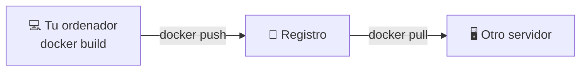
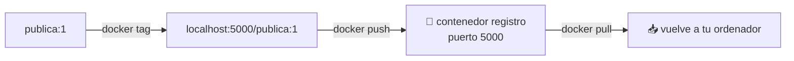

# 🐳 Docker · D09 (modo socrático): registros de imágenes

> 📅 Viernes 23 de octubre de 2026 · ⏱️ 30 min

## 📮 Plantilla de respuestas (lo primero)

> Cópiala **ahora** y ve rellenándola. Cuando termines, o quieras que corrija un tramo, pégala en el chat. Si no sabes algo, escribe `no sé`.

```text
══════════ CUESTIONARIO D08 ══════════
1:      2:      3:      4:
5 (V/F + motivo):
6:

══════════ PARTE 1 · ¿DÓNDE VIVE UNA IMAGEN? ══════════
1.1 Registro de cada nombre:
    nginx =
    usuario/app =
    ghcr.io/usuario/app:1.0 =
    localhost:5000/miapp:1.0 =
1.1 Cómo sé cuál es el registro (regla en una frase):
1.2 ¿Qué registro usa Docker si no pone ninguno?:

══════════ PARTE 2 · ETIQUETAR ══════════
2.1 Predicción (¿mismo IMAGE ID? ¿ocupa el doble?):
2.1 Resultado real:
2.2 ¿Qué etiqueta NO usaría en producción y por qué?:
2.2 Mis etiquetas para una versión 1.0.3:
2.3 Qué ventaja tiene el digest (sha256) sobre una etiqueta:

══════════ PARTE 3 · SUBIR Y BAJAR (registro local) ══════════
3.1 Qué hace cada opción de docker run -d -p 5000:5000 --name registro registry:2:
3.2 Comando para poner nombre de registro a mi imagen:
3.2 Predicción del push y resultado real:
3.3 Predicción tras borrar las dos etiquetas y hacer pull:
3.3 Resultado real:
3.4 Predicción: push de «publica:1» sin prefijo ¿a dónde intentaría subir?:

══════════ PARTE 4 ⭐ OPCIONAL · DOCKER HUB ══════════
4.1 Tres comandos (login, tag, push):
4.2 Qué error espero si no he hecho login:

══════════ CIERRE ══════════
Reflexión (2 frases):
Confianza 1-5:  nombres de imagen _   etiquetado _   push/pull _
```

---

**🎯 Objetivo:** entender **dónde viven** las imágenes y cómo subir y bajar las tuyas. Solo Docker, sin cuentas obligatorias: practicas con un registro **local**.

| Icono | Significa |
| :---: | :--- |
| 🤔 | **Pregunta** para pensar |
| ✍️ | **Escribe tu respuesta** |
| 💡 | **Pista** (ábrelas una a una) |
| 🧪 | **Experimento**: predice, ejecuta, compara |
| ⭐ | **Opcional** si vas justo de tiempo |

> [!IMPORTANT]
> Primero predice, después ejecuta. Si no tienes terminal, escribe solo las **predicciones** y los resultados los rellenas luego.

| ⏱️ Tiempo | 📚 Bloque |
| :---: | :--- |
| 4 min | 📝 Calentamiento: cuestionario de D08 |
| 5 min | 🌍 Parte 1: dónde vive una imagen |
| 7 min | 🏷️ Parte 2: etiquetar |
| 10 min | 📤 Parte 3: subir y bajar con un registro local |
| ⭐ 4 min | 🐳 Parte 4: Docker Hub (opcional) |

### 📊 Mi progreso

- [ ] Calentamiento D08
- [ ] Parte 1: registros
- [ ] Parte 2: etiquetas
- [ ] Parte 3: push y pull
- [ ] ⭐ Parte 4: Docker Hub
- [ ] Respuestas enviadas

---

## 📝 Calentamiento: ¿qué recuerdas de D08? `4 min`

### 1️⃣ Cambiar un archivo

Tu Dockerfile tiene `COPY . .` y justo después un paso que **instala dependencias**. Cambias un archivo de tu código y reconstruyes. ¿Qué pasa?

- **A)** Todo sale `CACHED`
- **B)** El paso de instalar dependencias se rehace
- **C)** El build falla
- **D)** Solo cambia la etiqueta

### 2️⃣ La regla del orden

¿Qué regla sale de ahí para ordenar un Dockerfile?

- **A)** Lo que cambia poco arriba, lo que cambia mucho abajo
- **B)** Lo que cambia mucho arriba, lo que cambia poco abajo
- **C)** El orden da igual
- **D)** Siempre `CMD` el primero

### 3️⃣ `.dockerignore`

¿Para qué sirve?

- **A)** Para ignorar errores del build
- **B)** Para no enviar ciertos archivos de tu carpeta a Docker al construir
- **C)** Para ocultar la imagen en `docker image ls`
- **D)** Para borrar contenedores

### 4️⃣ Multi-stage

¿Qué acaba dentro de la imagen final?

- **A)** Todas las fases
- **B)** Solo la primera fase
- **C)** Solo la última fase, más lo que copies con `COPY --from`
- **D)** Ninguna

### 5️⃣ Verdadero o falso

> «La fase `construir` aparece como una imagen en `docker image ls`».

✍️ Verdadero o Falso, con el motivo.

### 6️⃣ La pendiente de D08

Si en la fase 2 de `Dockerfile.multi` añadieras `COPY --from=construir /pesado.bin /pesado.bin`, `web-multi` pesaría:

- **A)** Lo mismo que ahora (102 MB)
- **B)** Casi lo mismo que `web-single` (155 MB)

---

## 🌍 Parte 1: ¿dónde vive una imagen? `5 min`

Un **registro** es un servidor donde se guardan imágenes. Tú ya lo usas: cuando haces `docker pull nginx`, Docker la baja de uno.



### 🤔 1.1 Lee los nombres

Una imagen puede escribirse así:

```text
nginx
usuario/app
ghcr.io/usuario/app:1.0
localhost:5000/miapp:1.0
```

✍️ Para cada nombre, ¿**en qué registro** crees que está?

✍️ Y de ahí saca una **regla**: ¿cómo se reconoce el registro dentro de un nombre?

<details>
<summary>💡 Pista 1</summary>

Mira la parte antes de la primera `/`. ¿Cuál de ellas parece una dirección web o una dirección con puerto?

</details>

<details>
<summary>💡 Pista 2</summary>

Cuando un nombre no tiene ninguna dirección delante, Docker tiene que usar uno «por defecto». Recuerda D05, cuando viste `docker.io/library/...`.

</details>

### 🤔 1.2 Los grandes

Estos son los registros más habituales: **Docker Hub, ghcr, ecr, gcr/Artifact Registry y acr**.

✍️ Con las pistas `gh` (GitHub), `aws`, `google` y `azure`, ¿a quién pertenece cada uno? Y ¿cuál es el que usa Docker si no pones ninguno?

---

## 🏷️ Parte 2: etiquetar `7 min`

Una imagen se identifica así:

```text
[registro/][usuario/]nombre:etiqueta
```

### 🧪 2.1 `docker tag`

Prepara una imagen pequeña. Todo va hecho: copia y pega.

```bash
mkdir -p ~/d09 && cd ~/d09
cat > Dockerfile <<'EOF'
FROM alpine
CMD ["echo", "hola desde el registro"]
EOF
docker build -t publica:1 .
docker tag publica:1 publica:latest
docker image ls publica
```

✍️ **Antes de ejecutar, predice:** `docker tag` ¿crea una imagen nueva o solo otro nombre? ¿Tendrán el mismo `IMAGE ID`? ¿Ocupará el doble?

✍️ Anota el resultado real.

<details>
<summary>💡 Pista</summary>

Mira la columna `IMAGE ID` de las dos filas y la columna `SIZE`.

</details>

### 🤔 2.2 Buenas prácticas

`latest` es la etiqueta que Docker usa por defecto (lo viste en D05).

✍️ **Responde:**
1. ¿Usarías `latest` para desplegar en producción? ¿Por qué sí o no?
2. Tu imagen sube a la versión `1.0.3`. ¿Qué etiquetas le pondrías para que otros puedan elegir entre «esta versión exacta» y «la última de la 1.0»?

<details>
<summary>💡 Pista</summary>

Piensa qué pasa si mañana alguien sube otra imagen y la etiqueta también como `latest`.

</details>

### 🤔 2.3 Más exacto que una etiqueta

Una etiqueta se puede **mover** a otra imagen. Existe otra forma de señalar una imagen que no se mueve, y se escribe como `nginx@sha256:...`.

✍️ ¿Qué ventaja crees que tiene sobre una etiqueta, y para qué te serviría en producción?

---

## 📤 Parte 3: subir y bajar con un registro local `10 min`

Sin cuenta ni internet: **tú mismo** montas un registro en un contenedor.



### 🧪 3.1 Arranca el registro

```bash
docker run -d -p 5000:5000 --name registro registry:2
```

✍️ ¿Qué hace cada parte del comando? Escribe una frase por `-d`, `-p 5000:5000` y `--name`.

### 🧪 3.2 Ponle nombre de registro y súbela

✍️ Escribe el comando `docker tag` que añada a `publica:1` el nombre `localhost:5000/publica:1`.

Luego:

```bash
docker push localhost:5000/publica:1
```

✍️ **Predice** qué verás en cada capa. Después anota lo real.

<details>
<summary>💡 Pista</summary>

El comando es `docker tag ORIGEN DESTINO`. Mira cómo lo escribiste en 2.1.

</details>

### 🧪 3.3 Borra y recupera

Borra las **tres** etiquetas locales para que la imagen desaparezca de tu ordenador:

```bash
docker rmi publica:1 publica:latest localhost:5000/publica:1
docker image ls publica
```

✍️ **Predice:** si ahora haces `docker pull localhost:5000/publica:1`, ¿volverá la imagen? ¿De dónde saldrá?

```bash
docker pull localhost:5000/publica:1
docker run --rm localhost:5000/publica:1
```

✍️ Anota el resultado.

### 🤔 3.4 ¿A dónde subiría?

Piensa sin ejecutar. Haces `docker push publica:1`, **sin** el prefijo `localhost:5000/`.

✍️ ¿A qué registro intentaría subirla Docker? ¿Crees que funcionaría sin hacer nada más?

<details>
<summary>💡 Pista</summary>

Vuelve a la regla que sacaste en 1.1 y a la respuesta de 1.2 sobre el registro por defecto.

</details>

---

## ⭐ Parte 4 (opcional): Docker Hub `4 min`

Solo si tienes cuenta de Docker Hub.

> [!WARNING]
> Usa un **token de acceso** de tu cuenta en lugar de tu contraseña, y **no lo pegues en el chat** ni en tus apuntes.

✍️ Escribe los **tres comandos** para subir `publica:1` a tu cuenta: iniciar sesión, dar el nombre `TU_USUARIO/publica:1` y subirla.

✍️ Si intentas el `push` **sin haber hecho login**, ¿qué tipo de error esperas?

---

## 🤔 Reflexión

✍️ En **dos frases**, explica con tus palabras qué es un registro y qué diferencia hay entre `docker push` y `docker pull`.

### 📈 ¿Qué tal me ha ido?

| Tema | 1 | 2 | 3 | 4 | 5 |
| :--- | :-: | :-: | :-: | :-: | :-: |
| Leer el nombre completo de una imagen | ☐ | ☐ | ☐ | ☐ | ☐ |
| Etiquetar bien | ☐ | ☐ | ☐ | ☐ | ☐ |
| Subir y bajar una imagen | ☐ | ☐ | ☐ | ☐ | ☐ |

---

## 📮 Entrega

Pega en el chat la **plantilla del principio** con lo que lleves. Corregiré el cuestionario y tus ejercicios, y te diré en qué te has equivocado y por qué.

---

➡️ **Siguiente sesión, D10:** Docker Compose y redes. Aprenderás a levantar varios contenedores juntos que se hablan entre sí.