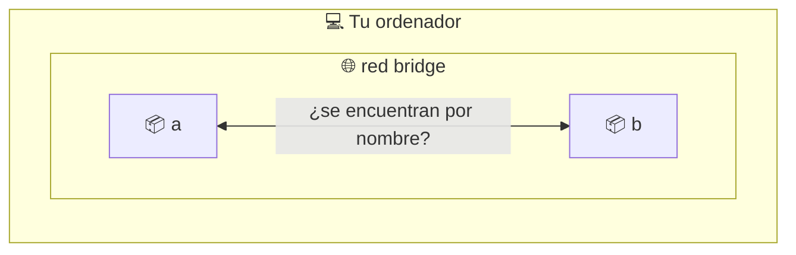
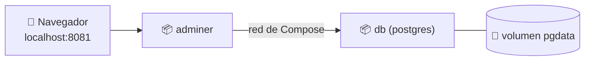

# 🐳 Docker · D10 (modo socrático): Docker Compose y redes

> 📅 Sábado 24 de octubre de 2026 · ⏱️ 60 min (con ⭐ lo imprescindible, unos 40)

## 📮 Plantilla de respuestas (lo primero)

> Cópiala **ahora** y ve rellenándola. Cuando termines, o quieras que corrija un tramo, pégala en el chat. Si no sabes algo, escribe `no sé`.

```text
══════════ CUESTIONARIO D09 ══════════
1:      2:      3:      4 (V/F + motivo):
5:      6:

══════════ PARTE 1 · REDES ══════════
1.1 Predicción (¿funciona ping a por nombre en la red por defecto?):
1.1 Resultado real:
1.2 Predicción (en mired):
1.2 Resultado real y por qué cambia:
1.3 Predicción (con --network host, ¿hace falta -p? ¿qué muestra docker port?):
1.3 Resultado real:
1.3 Un riesgo de usar host:

══════════ PARTE 2 · DE docker run A COMPOSE ══════════
2.1 Tres molestias de lanzar varios contenedores con docker run:
    a)
    b)
    c)
2.2 Mi docker-compose.yml (web nginx:alpine en 8080 + cache redis:7-alpine):
2.3 Predicción de docker compose ps:
2.3 Resultado real:
2.4 Predicción (¿web llega a cache por nombre? ¿quién creó la red?):
2.4 Resultado real:
2.5 Predicción (qué borra down y qué no):

══════════ PARTE 3 · MI APP CON VARIOS SERVICIOS ══════════
3.1 Mi docker-compose.yml (postgres 17 con volumen pgdata + adminer en 8081):
3.2 Qué escribo en «Servidor» dentro de Adminer y por qué NO localhost:
3.3 Predicción tras down y up -d (¿siguen los datos?):
3.3 Predicción tras down -v (¿y ahora?):
3.3 Resultado real:
3.4 ¿Publico el 5432 de db? Mi decisión y motivo:

══════════ CIERRE ══════════
Reflexión (2 frases, run frente a compose):
Confianza 1-5:  redes _   compose.yml _   nombre de servicio _   down/-v _
```

---

**🎯 Objetivo:** pasar de lanzar contenedores **uno a uno** a describir una aplicación con **varios servicios** en un archivo, y entender cómo se hablan entre sí. Solo Docker: usamos imágenes oficiales (nginx, redis, postgres), sin escribir código de ninguna aplicación.

| Icono | Significa |
| :---: | :--- |
| 🤔 | **Pregunta** para pensar |
| ✍️ | **Escribe tu respuesta** |
| 💡 | **Pista** (ábrelas una a una) |
| 🧪 | **Experimento**: predice, ejecuta, compara |
| ⭐ | **Imprescindible** si vas justo de tiempo |

> [!IMPORTANT]
> Primero predice, después ejecuta. Sin terminal, escribe solo las **predicciones**.

| ⏱️ Tiempo | 📚 Bloque |
| :---: | :--- |
| 5 min ⭐ | 📝 Calentamiento: cuestionario de D09 |
| 12 min ⭐ | 🌐 Parte 1: redes (1.1 y 1.2 imprescindibles) |
| 15 min ⭐ | 📄 Parte 2: de `docker run` a Compose |
| 25 min | 🛠️ Parte 3: postgres + adminer (3.1 a 3.3 ⭐) |
| 3 min | 🤔 Cierre |

> [!NOTE]
> Los archivos YAML son sensibles a los **espacios**: se sangra con **2 espacios**, nunca con tabuladores.

### 📊 Mi progreso

- [ ] Calentamiento D09
- [ ] Parte 1: redes
- [ ] Parte 2: Compose
- [ ] Parte 3: mi app
- [ ] Respuestas enviadas

---

## 📝 Calentamiento: ¿qué recuerdas de D09? `5 min`

### 1️⃣ El registro por defecto

Si no escribes ningún registro en el nombre, ¿de cuál baja Docker?

- **A)** GitHub
- **B)** Docker Hub
- **C)** AWS
- **D)** Tu ordenador

### 2️⃣ Leer un nombre

En `ghcr.io/usuario/app:1.0`, ¿qué parte indica el registro?

- **A)** `ghcr.io`
- **B)** `usuario`
- **C)** `app`
- **D)** `1.0`

### 3️⃣ `docker tag`

¿Qué hace `docker tag publica:1 publica:latest`?

- **A)** Descarga una imagen nueva
- **B)** Duplica la imagen y ocupa el doble
- **C)** Da otro nombre a la misma imagen
- **D)** Borra la etiqueta `1`

### 4️⃣ Verdadero o falso

> «La etiqueta `latest` garantiza que es la versión más nueva».

✍️ Verdadero o Falso, con el motivo.

### 5️⃣ El comando

¿Qué comando pone a `publica:1` el nombre `localhost:5000/publica:1`?

- **A)** `docker push publica:1`
- **B)** `docker tag publica:1 localhost:5000/publica:1`
- **C)** `docker pull localhost:5000/publica:1`
- **D)** `docker rename publica:1 localhost:5000`

### 6️⃣ El digest

¿Qué ventaja tiene `nginx@sha256:...` sobre una etiqueta?

- **A)** Señala siempre el mismo contenido y no se mueve
- **B)** Es más corto
- **C)** Descarga más rápido
- **D)** Se actualiza solo

---

## 🌐 Parte 1: redes `12 min`

Cada contenedor tiene su propia red. Por defecto Docker los conecta a una red llamada **`bridge`**.



### 🧪 1.1 ⭐ Dos contenedores, red por defecto

```bash
docker run -dit --name a alpine
docker run -dit --name b alpine
docker exec b ping -c 1 a
```

✍️ **Antes de ejecutar, predice:** ¿funcionará el `ping` a `a` usando su nombre?

✍️ Anota lo que ves.

<details>
<summary>💡 Pista</summary>

Recuerda D04: `docker network` y la opción `--network`. ¿Qué tienen las redes que tú creas y la red por defecto no?

</details>

### 🧪 1.2 ⭐ Una red propia

```bash
docker rm -f a b
docker network create mired
docker run -dit --name a --network mired alpine
docker run -dit --name b --network mired alpine
docker exec b ping -c 1 a
```

✍️ **Predice** el resultado antes de ejecutar y compáralo con 1.1.

✍️ ¿Qué crees que ha cambiado entre las dos? Escribe tu hipótesis.

### 🧪 1.3 La red `host`

```bash
docker rm -f a b
docker run -d --name h --network host nginx:alpine
docker port h
```

✍️ **Predice:** esta vez **no** pones `-p`. ¿Podrás abrir `http://localhost:80`? ¿Qué mostrará `docker port h`?

✍️ Anota lo real. Después responde: ¿qué **riesgo** tendría usar `host` con muchos contenedores?

<details>
<summary>💡 Pista</summary>

Con `host`, el contenedor **comparte** la red de tu ordenador. Piensa qué pasa si dos usan el mismo puerto.

</details>

```bash
docker rm -f h
docker network rm mired
```

---

## 📄 Parte 2: de `docker run` a Compose `15 min`

### 🤔 2.1 ⭐ El problema

Imagina arrancar una web y una caché a mano:

```bash
docker network create app
docker run -d --name cache --network app redis:7-alpine
docker run -d --name web --network app -p 8080:80 nginx:alpine
```

Con 5 o 6 servicios, y volúmenes, variables y reinicios, esto se complica.

✍️ Escribe **tres molestias** de hacerlo así.

### 🤔 2.2 ⭐ Escribe tu primer Compose

**Docker Compose** describe todo en un archivo. Aquí tienes el esqueleto:

```yaml
services:
  web:
    image: ❓
    ports:
      - "❓"
  cache:
    image: ❓
```

✍️ Completa los `❓` para tener la **web en el puerto 8080** (nginx:alpine) y la **caché redis:7-alpine**.

<details>
<summary>💡 Pista 1</summary>

Compara cada línea con el `docker run` de 2.1: `image` es la imagen y `ports` es lo que va tras `-p`.

</details>

<details>
<summary>💡 Pista 2</summary>

No hace falta escribir `version:` ni `container_name:`. Las versiones modernas de Compose lo ignoran.

</details>

Guárdalo como `docker-compose.yml` en una carpeta nueva (`~/d10`) y arranca:

```bash
docker compose up -d
docker compose ps
```

### 🧪 2.3 ⭐ Mira lo que ha creado

✍️ **Predice:** ¿cuántos contenedores verás en `docker compose ps`? ¿Qué nombre tendrá cada uno?

✍️ Anota el resultado.

### 🧪 2.4 ⭐ ¿Se ven por nombre?

No has creado ninguna red.

```bash
docker network ls
docker compose exec web ping -c 1 cache
```

✍️ **Predice:** ¿funcionará el `ping` por el nombre `cache`? ¿Y quién habrá creado la red que usan?

✍️ Anota lo real. Compara con 1.1 y 1.2.

<details>
<summary>💡 Pista</summary>

Mira `docker network ls`: ¿hay alguna red con el nombre de tu carpeta?

</details>

### 🧪 2.5 Apagar

✍️ **Predice:** `docker compose down` ¿qué borra? ¿Qué queda?

```bash
docker compose down
docker ps -a
docker network ls
```

---

## 🛠️ Parte 3: mi app con varios servicios `25 min`

**Objetivo:** una base de datos **Postgres** con una interfaz web (**Adminer**), todo en un archivo. Adminer es una imagen oficial lista para usar: no hay código que escribir.



### 🧪 3.1 ⭐ Escribe el archivo

Crea una carpeta nueva `~/d10-db` con un `docker-compose.yml` que tenga:

1. Un servicio **`db`**: imagen `postgres:17`, contraseña `abc` y los datos en un volumen llamado `pgdata`.
2. Un servicio **`adminer`**: imagen `adminer`, publicando su puerto interno `8080` en `8081` de tu ordenador.
3. La declaración del volumen.

✍️ Escribe el archivo completo.

<details>
<summary>💡 Pista 1</summary>

Para las variables usa la clave `environment`. Para el volumen, `volumes` dentro del servicio con el formato `nombre:ruta`, igual que `-v` en D06.

</details>

<details>
<summary>💡 Pista 2</summary>

Los volúmenes con nombre se declaran **también** en un bloque `volumes:` al nivel de `services:`. Piensa dónde queda ese bloque en la indentación.

</details>

<details>
<summary>💡 Pista 3</summary>

La ruta de datos de Postgres en el contenedor la averiguaste en D06 con `docker inspect`.

</details>

```bash
docker compose up -d
docker compose ps
```

### 🧪 3.2 ⭐ Conéctate

Abre `http://localhost:8081`. Adminer pide: sistema **PostgreSQL**, servidor, usuario `postgres`, contraseña `abc`.

✍️ **Predice** qué escribirías en **Servidor**: `localhost`, `db`, `127.0.0.1` o `5432`. Después pruébalo.

✍️ **Responde:** ¿por qué `localhost` **no** funciona desde Adminer?

<details>
<summary>💡 Pista</summary>

¿Qué es `localhost` visto desde **dentro** del contenedor de Adminer? ¿Y cómo se llamaba `cache` en 2.4?

</details>

### 🧪 3.3 ⭐ Los datos

Crea cualquier cosa en Adminer (una tabla vacía basta). Luego:

```bash
docker compose down
docker compose up -d
```

✍️ **Predice:** ¿seguirá lo que creaste? Después prueba con `down -v`:

```bash
docker compose down -v
docker compose up -d
```

✍️ **Predice** de nuevo y anota lo real. ¿Qué diferencia hay entre `down` y `down -v`?

### 🤔 3.4 ¿Publico el puerto de la base de datos?

Ahora mismo `db` no tiene `ports`, y Adminer llega a ella igualmente.

✍️ ¿Publicarías el `5432` de `db`? Decide y justifica pensando en **seguridad**. Pista: recuerda lo que viste en D05 sobre `-p 127.0.0.1:...`.

```bash
docker compose down -v
```

---

## 🤔 Reflexión

✍️ En **dos frases**, explica cuándo usarías `docker run` y cuándo `docker compose`.

### 📈 ¿Qué tal me ha ido?

| Tema | 1 | 2 | 3 | 4 | 5 |
| :--- | :-: | :-: | :-: | :-: | :-: |
| Redes: bridge, red propia y host | ☐ | ☐ | ☐ | ☐ | ☐ |
| Escribir un `docker-compose.yml` | ☐ | ☐ | ☐ | ☐ | ☐ |
| Hablar con otro servicio por su nombre | ☐ | ☐ | ☐ | ☐ | ☐ |
| `down` frente a `down -v` | ☐ | ☐ | ☐ | ☐ | ☐ |

---

## 📮 Entrega

Pega en el chat la **plantilla del principio** con lo que lleves. Corregiré el cuestionario y tus ejercicios, y te diré en qué te has equivocado y por qué.

---

➡️ **Siguiente sesión, D11:** seguridad: escaneo de vulnerabilidades, usuario no root y límites de recursos.