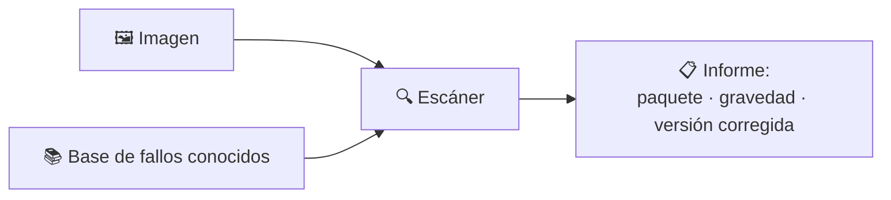
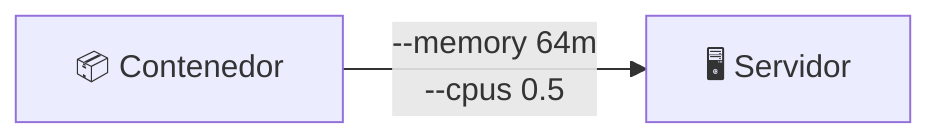

# 🐳 Docker · D11 (modo socrático): seguridad

> 📅 Domingo 25 de octubre de 2026 · ⏱️ 45 min (con ⭐ lo imprescindible, unos 30)

## 📮 Plantilla de respuestas (lo primero)

> Cópiala **ahora** y ve rellenándola. Cuando termines, o quieras que corrija un tramo, pégala en el chat. Si no sabes algo, escribe `no sé`.

```text
══════════ CUESTIONARIO D10 ══════════
1:      2:      3:      4:
5 (V/F + motivo):

══════════ PARTE 1 · ESCANEAR IMÁGENES ══════════
1.1 Predicción (¿cuál tiene más vulnerabilidades, nginx:1.21 o nginx:alpine?):
1.1 Resultado real (línea «Total»):
1.2 Qué significan HIGH y CRITICAL, y por cuál empiezo:
1.3 Predicción tras cambiar a una imagen base más nueva:
1.3 Resultado real:
1.3 ¿Se arregla todo? ¿Cómo lo sé?:
1.4 Riesgo de montar /var/run/docker.sock en un contenedor:

══════════ PARTE 2 · USUARIO NO ROOT ══════════
2.1 Predicción (id por defecto y con --user 1000:1000):
2.1 Resultado real:
2.2 Predicción (escribir en /etc como usuario 1000):
2.2 Resultado real:
2.3 Mi Dockerfile con USER (completo):
2.3 Predicción de lo que imprime id:
2.3 Resultado real:
2.4 Por qué conviene no ejecutar como root:

══════════ PARTE 3 · LÍMITES DE RECURSOS ══════════
3.1 Predicción (valor de HostConfig.Memory con --memory 64m):
3.1 Resultado real:
3.2 Qué pasa si un contenedor con límite intenta usar más memoria:
3.2 Qué pasa si NO tiene límite:

══════════ PARTE 4 ⭐ OPCIONAL · ENDURECER ══════════
4.1 Predicción (escribir con --read-only):
4.1 Resultado real:
4.2 Para qué sirve --cap-drop ALL:

══════════ CIERRE ══════════
Reflexión (3 medidas de seguridad que aplicaría siempre):
Confianza 1-5:  escanear _   usuario no root _   límites _   endurecer _
```

---

**🎯 Objetivo:** buscar **vulnerabilidades** en una imagen, ejecutar sin privilegios de administrador y poner **límites** a un contenedor. Todo con herramientas de Docker y sin código de ninguna aplicación.

| Icono | Significa |
| :---: | :--- |
| 🤔 | **Pregunta** para pensar |
| ✍️ | **Escribe tu respuesta** |
| 💡 | **Pista** (ábrelas una a una) |
| 🧪 | **Experimento**: predice, ejecuta, compara |
| ⭐ | **Imprescindible** si vas justo de tiempo |

> [!IMPORTANT]
> Primero predice, después ejecuta. Sin terminal, escribe solo las **predicciones**.

| ⏱️ Tiempo | 📚 Bloque |
| :---: | :--- |
| 4 min ⭐ | 📝 Calentamiento: cuestionario de D10 |
| 12 min ⭐ | 🔍 Parte 1: escanear imágenes |
| 12 min ⭐ | 👤 Parte 2: usuario no root |
| 8 min | 📊 Parte 3: límites de recursos |
| ⭐ 5 min | 🛡️ Parte 4: endurecer (opcional) |
| 4 min | 🤔 Cierre |

### 📊 Mi progreso

- [ ] Calentamiento D10
- [ ] Parte 1: escanear
- [ ] Parte 2: no root
- [ ] Parte 3: límites
- [ ] ⭐ Parte 4: endurecer
- [ ] Respuestas enviadas

---

## 📝 Calentamiento: ¿qué recuerdas de D10? `4 min`

### 1️⃣ La red por defecto

En la red `bridge` que Docker crea por defecto, ¿dos contenedores se encuentran por **nombre**?

- **A)** Sí, siempre
- **B)** No
- **C)** Solo con `-p`
- **D)** Solo si usan la misma imagen

### 2️⃣ Una red propia

Con una red creada por ti (`docker network create mired`), ¿se encuentran por nombre?

- **A)** Sí
- **B)** No
- **C)** Solo con `--network host`
- **D)** Solo con Compose

### 3️⃣ Compose y la red

En un proyecto Compose, ¿quién crea la red en la que están los servicios?

- **A)** Tú, a mano
- **B)** El contenedor `web`
- **C)** Compose, automáticamente
- **D)** Nadie: no hay red

### 4️⃣ `down -v`

¿Qué hace `docker compose down -v` de más respecto a `docker compose down`?

- **A)** Nada
- **B)** Borra también los volúmenes con nombre
- **C)** Borra las imágenes
- **D)** Detiene el daemon

### 5️⃣ Verdadero o falso

> «En Adminer, en el campo Servidor, sirve poner `localhost` para llegar a la base de datos `db`».

✍️ Verdadero o Falso, con el motivo.

---

## 🔍 Parte 1: escanear imágenes `12 min`

Una imagen incluye un sistema y paquetes. Si algún paquete tiene un fallo conocido (una **vulnerabilidad**), tu contenedor hereda el riesgo.



Usaremos un escáner que corre **en un contenedor**: no hay que instalar nada. La primera vez descarga su base de datos y tarda un poco.

### 🧪 1.1 ⭐ Compara dos imágenes

```bash
docker run --rm aquasec/trivy:latest image --quiet --severity HIGH,CRITICAL nginx:1.21
docker run --rm aquasec/trivy:latest image --quiet --severity HIGH,CRITICAL nginx:alpine
```

✍️ **Antes de ejecutar, predice:** ¿cuál tendrá **más** vulnerabilidades graves, `nginx:1.21` o `nginx:alpine`? ¿Por qué?

✍️ Anota la línea `Total: N (HIGH: x, CRITICAL: y)` de cada una.

<details>
<summary>💡 Pista</summary>

Recuerda D05: «no la actualiza en más de 3 años». ¿Qué le pasa a una imagen que no se actualiza?

</details>

### 🤔 1.2 ⭐ Leer el informe

En la tabla verás columnas como `Library`, `Vulnerability`, `Severity` y `Fixed Version`.

✍️ **Responde:**
1. ¿Qué crees que significan `HIGH` y `CRITICAL`? ¿Por cuál empezarías a arreglar?
2. Si `Fixed Version` está **vacío**, ¿qué te dice?

### 🧪 1.3 ⭐ Arréglalo

Esta imagen vieja y su versión actual:

```bash
docker run --rm aquasec/trivy:latest image --quiet --severity HIGH,CRITICAL alpine:3.14
docker run --rm aquasec/trivy:latest image --quiet --severity HIGH,CRITICAL alpine:3.20
```

✍️ **Predice:** el «arreglo» aquí es solo cambiar la etiqueta de la imagen base. ¿Cuánto bajará el número? Después anota lo real.

✍️ ¿Se arregla **todo** con eso? ¿Cómo lo sabes mirando el informe?

### 🤔 1.4 El escáner y el socket

Para escanear **tus** imágenes locales, el escáner necesita hablar con Docker. Suele hacerse montando un archivo especial:

```bash
-v /var/run/docker.sock:/var/run/docker.sock
```

Ese archivo es la puerta al **daemon de Docker**, el `dockerd` de D02.

✍️ Si montas ese archivo en un contenedor, ¿qué crees que puede hacer ese contenedor con Docker? ¿Qué riesgo tiene?

<details>
<summary>💡 Pista</summary>

Piensa: ¿quién manda en Docker? Si el contenedor puede dar órdenes a `dockerd`, ¿puede crear otros contenedores, borrar los tuyos, montar tus carpetas...?

</details>

---

## 👤 Parte 2: usuario no root `12 min`

Por defecto, un contenedor ejecuta su programa como **root** (administrador) dentro de él.

### 🧪 2.1 ⭐ ¿Quién soy?

```bash
docker run --rm alpine id
docker run --rm --user 1000:1000 alpine id
```

✍️ **Predice** qué mostrará cada comando. Después compáralo con lo que ves.

### 🧪 2.2 ⭐ ¿Qué puedo hacer?

```bash
docker run --rm alpine sh -c 'echo prueba > /etc/prueba && echo ok'
docker run --rm --user 1000:1000 alpine sh -c 'echo prueba > /etc/prueba && echo ok'
```

✍️ **Predice** el resultado de cada uno. Después anota lo real.

### 🧪 2.3 ⭐ Hazlo en la imagen

En vez de pasar `--user` cada vez, se deja dentro del Dockerfile con la instrucción `USER`.

Aquí tienes el esqueleto. Tú completas el `❓`:

```dockerfile
FROM alpine
RUN adduser -D app
❓
CMD ["id"]
```

✍️ Escribe el Dockerfile completo (qué instrucción y con qué valor va en el `❓`).

<details>
<summary>💡 Pista</summary>

`adduser -D app` **crea** un usuario llamado `app`. Falta decirle a Docker que, a partir de ahí, use ese usuario.

</details>

```bash
mkdir -p ~/d11 && cd ~/d11
# guarda aquí tu Dockerfile
docker build -t segura .
docker run --rm segura
```

✍️ **Predice** lo que imprime `id` y compara.

### 🤔 2.4 ¿Para qué?

✍️ Si alguien se aprovecha de un fallo de tu aplicación, ¿qué diferencia hay entre que se ejecute como `root` o como `app`? Explícalo en una frase.

---

## 📊 Parte 3: límites de recursos `8 min`

Un contenedor puede usar toda la memoria y CPU del servidor si nadie le pone límite.



### 🧪 3.1 Límites

```bash
docker run -d --name lim --memory 64m --cpus 0.5 alpine sleep 3600
docker inspect --format '{{.HostConfig.Memory}}' lim
docker stats --no-stream lim
```

✍️ **Predice:** ¿qué número saldrá en el primer `inspect`? Pista: es la cantidad en **bytes**. Después anota lo real.

✍️ En `docker stats`, ¿en qué columna ves el límite que pusiste?

```bash
docker rm -f lim
```

### 🤔 3.2 Cuando se pasa

✍️ **Responde:**
1. Un contenedor con `--memory 64m` intenta usar 200 MB. ¿Qué crees que hace Linux con él?
2. Y si **no** tuviera límite, ¿qué podría pasarle a los demás contenedores del servidor?

<details>
<summary>💡 Pista</summary>

El contenedor se queda sin memoria. Piensa en cómo reacciona un sistema cuando se le acaba: alguien tiene que parar.

</details>

---

## ⭐ Parte 4 (opcional): endurecer `5 min`

### 🧪 4.1 Sistema de solo lectura

```bash
docker run --rm --read-only alpine sh -c 'echo x > /prueba && echo ok'
docker run --rm --read-only --tmpfs /tmp alpine sh -c 'echo x > /tmp/prueba && echo ok'
```

✍️ **Predice** cada resultado. Después anota. Recuerda `tmpfs` de D06.

### 🤔 4.2 Más opciones

Existen estas dos opciones más: `--cap-drop ALL` y `--security-opt no-new-privileges`.

✍️ Con lo que has visto, ¿qué crees que hace cada una? Escribe tu hipótesis y, si quieres, compruébala en la documentación de Docker.

---

## 🤔 Reflexión

✍️ Escribe **tres medidas de seguridad** que aplicarías a todas tus imágenes y contenedores a partir de ahora.

### 📈 ¿Qué tal me ha ido?

| Tema | 1 | 2 | 3 | 4 | 5 |
| :--- | :-: | :-: | :-: | :-: | :-: |
| Escanear una imagen y leer el informe | ☐ | ☐ | ☐ | ☐ | ☐ |
| Ejecutar como usuario no root | ☐ | ☐ | ☐ | ☐ | ☐ |
| Límites de memoria y CPU | ☐ | ☐ | ☐ | ☐ | ☐ |
| Endurecer un contenedor | ☐ | ☐ | ☐ | ☐ | ☐ |

---

## 📮 Entrega

Pega en el chat la **plantilla del principio** con lo que lleves. Corregiré el cuestionario y tus ejercicios, y te diré en qué te has equivocado y por qué.

---

➡️ **Siguiente sesión, D12:** experiencia de desarrollo: trabajar con Docker mientras programas.