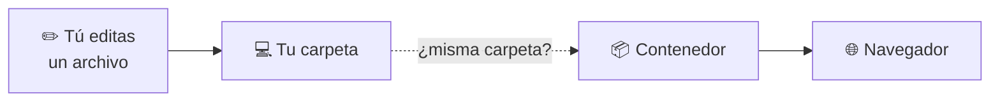
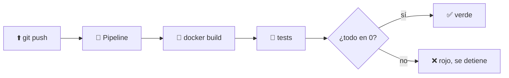

# 🐳 Docker · D12 (modo socrático): experiencia de desarrollo

> 📅 Lunes 26 de octubre de 2026 · ⏱️ 60 min (con ⭐ lo imprescindible, unos 40)

## 📮 Plantilla de respuestas (lo primero)

> Cópiala **ahora** y ve rellenándola. Cuando termines, o quieras que corrija un tramo, pégala en el chat. Si no sabes algo, escribe `no sé`.

```text
══════════ CUESTIONARIO D11 ══════════
1:      2:      3:      4:
5 (V/F + motivo):

══════════ PARTE 1 · RECARGA EN CALIENTE ══════════
1.1 Predicción (cambio index.html en mi ordenador: ¿lo veo sin reiniciar?):
1.1 Resultado real y por qué:
1.2 Predicción (si la web estuviera copiada con COPY: ¿qué haría falta?):
1.2 Resultado real:
1.3 Qué efecto tiene :ro sobre mí y sobre el contenedor:
1.4 Cuándo uso bind mount y cuándo COPY (desarrollo / producción):
1.5 ⭐ OPCIONAL · Qué hace «docker compose watch»:

══════════ PARTE 2 · PROBAR Y DEPURAR ══════════
2.1 Predicción de los códigos de salida (exit 3, exit 0):
2.1 Resultado real:
2.2 Qué hace falla un «test» en CI:
2.3 Predicción de test -f (/etc/alpine-release y /etc/no-existe):
2.3 Resultado real:
2.4 Mi comando de entorno desechable:
2.5 Dos comandos para mirar un contenedor que se porta mal:
2.6 Qué necesito para conectar un depurador y cómo lo hago seguro:

══════════ PARTE 3 · INTEGRACIÓN CONTINUA ══════════
3.1 Mi workflow completo (línea trigger y línea run):
3.2 Por qué etiquetar con el SHA del commit y no con latest:
3.3 Orden de los pasos de un pipeline y qué pasa si uno falla:

══════════ CIERRE ══════════
Reflexión (2 frases: desarrollo frente a producción):
Confianza 1-5:  recarga en caliente _   códigos de salida _   depurar _   CI _
```

---

**🎯 Objetivo:** trabajar con Docker **mientras desarrollas**: ver los cambios al instante, probar con comandos y dejar que un pipeline construya tu imagen solo. Sin programar en ningún lenguaje: usamos nginx y alpine.

| Icono | Significa |
| :---: | :--- |
| 🤔 | **Pregunta** para pensar |
| ✍️ | **Escribe tu respuesta** |
| 💡 | **Pista** (ábrelas una a una) |
| 🧪 | **Experimento**: predice, ejecuta, compara |
| ⭐ | **Imprescindible** si vas justo de tiempo |

> [!IMPORTANT]
> Primero predice, después ejecuta. Sin terminal, escribe solo las **predicciones**.

| ⏱️ Tiempo | 📚 Bloque |
| :---: | :--- |
| 4 min ⭐ | 📝 Calentamiento: cuestionario de D11 |
| 14 min ⭐ | 🔥 Parte 1: recarga en caliente |
| 14 min | 🧪 Parte 2: probar y depurar (2.1 y 2.3 ⭐) |
| 20 min ⭐ | 🤖 Parte 3: integración continua |
| 5 min | 🤔 Cierre |

### 📊 Mi progreso

- [ ] Calentamiento D11
- [ ] Parte 1: recarga en caliente
- [ ] Parte 2: probar y depurar
- [ ] Parte 3: CI
- [ ] Respuestas enviadas

---

## 📝 Calentamiento: ¿qué recuerdas de D11? `4 min`

### 1️⃣ ¿Quién soy?

`docker run --rm alpine id` muestra:

- **A)** `uid=1000(app)`
- **B)** `uid=65534(nobody)`
- **C)** `uid=0(root)`
- **D)** Error

### 2️⃣ La instrucción `USER`

¿Qué hace `USER app` en un Dockerfile?

- **A)** Crea el usuario `app`
- **B)** Hace que el proceso se ejecute como `app` en lugar de root
- **C)** Da permisos de administrador a `app`
- **D)** Elimina el usuario `root`

### 3️⃣ Pasarse de memoria

Un contenedor con `--memory 64m` intenta usar mucha más. ¿Qué hace Linux?

- **A)** Lo detiene (lo mata por falta de memoria)
- **B)** Le da más memoria
- **C)** Lo ralentiza para siempre
- **D)** No hace nada

### 4️⃣ Leer un escáner

Un informe lista vulnerabilidades `MEDIUM`, `HIGH` y `CRITICAL`. ¿Cuál es la regla básica para empezar a arreglar?

- **A)** Por orden alfabético
- **B)** Por las más graves primero: `CRITICAL` y `HIGH`
- **C)** Por las de menor número
- **D)** Da igual el orden

### 5️⃣ Verdadero o falso

> «Montar `/var/run/docker.sock` en un contenedor es seguro».

✍️ Verdadero o Falso, con el motivo.

---

## 🔥 Parte 1: recarga en caliente `14 min`

Quieres editar tu proyecto y **ver el cambio al momento**, sin reconstruir la imagen cada vez.



### 🧪 1.1 ⭐ Una web que cambia sola

Todo va hecho: copia y pega.

```bash
mkdir -p ~/d12/html && cd ~/d12
echo "<h1>Versión 1</h1>" > html/index.html
docker run -d --name dev -p 8080:80 -v "$PWD/html":/usr/share/nginx/html:ro nginx:alpine
curl http://localhost:8080
```

Ahora **cambias el archivo en tu ordenador**:

```bash
echo "<h1>Versión 2</h1>" > html/index.html
```

✍️ **Antes de ejecutar el siguiente comando, predice:** ¿qué mostrará `curl http://localhost:8080`? ¿Hace falta reiniciar el contenedor?

```bash
curl http://localhost:8080
```

✍️ Anota lo real y explica **por qué** pasa. Pista: ¿qué tipo de montaje es?

<details>
<summary>💡 Pista</summary>

La parte izquierda de `-v` es una carpeta de tu ordenador. Recuerda D06: ¿es volumen, bind mount o tmpfs?

</details>

### 🤔 1.2 ⭐ Y si estuviera dentro de la imagen

En D07 hiciste `COPY index.html ...` dentro de la imagen.

✍️ **Responde:** con esa web copiada en la imagen, si editas `index.html` en tu ordenador, ¿se ve el cambio? ¿Qué pasos harían falta?

### 🤔 1.3 El `:ro`

Pusiste `:ro` al final del montaje y aun así pudiste editar el archivo.

✍️ ¿Para quién es de solo lectura, para el contenedor o para ti? ¿Por qué tiene sentido en este caso?

### 🤔 1.4 ⭐ ¿Cuál para qué?

✍️ Completa:
- En **desarrollo** uso ______ porque ______.
- En **producción** uso ______ porque ______.

<details>
<summary>💡 Pista</summary>

Es la misma decisión que tomaste en D08 sobre la web que cambia a diario frente a la que se despliega en 10 servidores.

</details>

### 🧪 1.5 ⭐ (opcional) `docker compose watch`

Compose puede **sincronizar** archivos por ti, sin bind mount. Crea `~/d12/docker-compose.yml`:

```yaml
services:
  web:
    image: nginx:alpine
    ports:
      - "8081:80"
    develop:
      watch:
        - action: sync
          path: ./html
          target: /usr/share/nginx/html
```

```bash
docker rm -f dev
docker compose watch
```

> [!WARNING]
> **Sin verificar.** `watch` requiere una versión reciente de Compose y la sintaxis puede variar. Si algo falla, pégame el error o míralo en la documentación de Compose.

✍️ En tus palabras: ¿qué diferencia ves entre esto y el bind mount de 1.1? Cuando termines, `Ctrl+C` y `docker compose down`.

```bash
docker rm -f dev 2>/dev/null
```

---

## 🧪 Parte 2: probar y depurar `14 min`

### 🧪 2.1 ⭐ El código de salida

Todo comando que termina deja un **número**: `0` si fue bien y otro número si fue mal. El shell lo guarda en `$?`.

```bash
docker run --rm alpine sh -c "exit 3"; echo $?
docker run --rm alpine sh -c "exit 0"; echo $?
```

✍️ **Predice** qué número saldrá en cada caso. Después anota lo real.

### 🤔 2.2 ⭐ ¿Qué es un «test» para CI?

✍️ Con lo que acabas de ver, ¿cómo crees que un sistema automático sabe si algo **ha fallado**?

### 🧪 2.3 ⭐ Un test sin código

```bash
docker run --rm alpine sh -c "test -f /etc/alpine-release"; echo $?
docker run --rm alpine sh -c "test -f /etc/no-existe"; echo $?
```

`test -f` comprueba que un archivo existe.

✍️ **Predice** los dos números y anota lo real.

### 🧪 2.4 Un entorno desechable

Para probar cosas sin instalar nada en tu ordenador:

```bash
docker run -it --rm -v "$PWD":/work -w /work alpine sh
```

✍️ Escribe, con tus palabras, qué hace **cada parte** del comando: `-it`, `--rm`, `-v "$PWD":/work` y `-w /work`. ¿Qué pasa con lo que instales dentro? ¿Y con los archivos de `/work`?

### 🤔 2.5 Un contenedor se porta mal

✍️ Escribe **dos comandos** que usarías para investigar un contenedor en marcha que no responde: uno para ver lo que cuenta y otro para entrar a mirar.

<details>
<summary>💡 Pista</summary>

Uno lo usaste en D05 con Postgres y el otro en D03.

</details>

### 🤔 2.6 Depuradores

Un **depurador** te deja parar un programa línea a línea desde tu editor. Si el programa está **dentro de un contenedor**, tu editor necesita llegar a él.

✍️ **Responde:**
1. ¿Qué necesitas hacer con el puerto del depurador para que tu editor llegue?
2. ¿Cómo lo harías para que solo tu ordenador pueda conectarse? Pista: D05, `-p 127.0.0.1:...`

---

## 🤖 Parte 3: integración continua `20 min`

La **integración continua** (CI) hace que, **cada vez que subes código**, un servidor construya y pruebe tu proyecto automáticamente.



### 🧪 3.1 ⭐ Escribe tu primer pipeline

Se escribe en un archivo YAML dentro del repositorio. Este es el de **GitHub Actions**. Completa los `❓`:

```yaml
name: build
on:
  ❓:
    branches: [main]
jobs:
  build:
    runs-on: ubuntu-latest
    steps:
      - uses: actions/checkout@v4
      - name: Construir imagen
        run: ❓
```

Se guardaría como `.github/workflows/build.yml`.

✍️ Completa:
1. **Cuándo** se ejecuta: el evento que ocurre al subir código.
2. **Qué comando** construye la imagen `miapp` con la etiqueta `${{ github.sha }}`.

<details>
<summary>💡 Pista 1</summary>

La primera línea con `❓` es el nombre del evento cuando subes código. Mira el `branches: [main]`.

</details>

<details>
<summary>💡 Pista 2</summary>

El comando es el mismo que usas en tu terminal. `${{ github.sha }}` es la etiqueta que debe ir tras los `:`.

</details>

> [!NOTE]
> No necesitas un repositorio de GitHub para este ejercicio: solo escribirlo. Si tienes uno, puedes subir el archivo y mirar la pestaña «Actions».

### 🤔 3.2 ⭐ La etiqueta

`${{ github.sha }}` es el identificador único del commit que se está construyendo.

✍️ ¿Por qué es mejor etiquetar así que con `latest`? Recuerda D09.

<details>
<summary>💡 Pista</summary>

Si mañana dos commits distintos se etiquetan `latest`, ¿puedes saber cuál es cuál? ¿Y con el SHA?

</details>

### 🤔 3.3 El orden

Un pipeline suele ir así: **traer el código → construir → probar → subir la imagen a un registro**.

✍️ **Responde:**
1. Si falla el paso de pruebas (código distinto de `0`), ¿debería llegar a subirse la imagen al registro? ¿Por qué?
2. ¿Qué parte de la Parte 2 usa el pipeline para saber que algo falló?

### 🎯 Reto

✍️ Añade al pipeline un **paso más** después de construir: ejecutar la imagen y comprobar que `/etc/alpine-release` existe con el comando de 2.3. No hace falta que funcione; escribe cómo quedaría el paso.

<details>
<summary>💡 Pista</summary>

Es otro bloque `- name: ... run: ...` con el mismo formato que el de construir.

</details>

---

## 🤔 Reflexión

✍️ En **dos frases**, explica qué haces distinto con Docker cuando **desarrollas** y cuando **despliegas**.

### 📈 ¿Qué tal me ha ido?

| Tema | 1 | 2 | 3 | 4 | 5 |
| :--- | :-: | :-: | :-: | :-: | :-: |
| Recarga en caliente con bind mount | ☐ | ☐ | ☐ | ☐ | ☐ |
| Códigos de salida y tests | ☐ | ☐ | ☐ | ☐ | ☐ |
| Depurar un contenedor | ☐ | ☐ | ☐ | ☐ | ☐ |
| Leer y escribir un pipeline de CI | ☐ | ☐ | ☐ | ☐ | ☐ |

---

## 📮 Entrega

Pega en el chat la **plantilla del principio** con lo que lleves. Corregiré el cuestionario y tus ejercicios, y te diré en qué te has equivocado y por qué.

---

➡️ **Siguiente sesión, D13:** despliegue: comparar opciones (Swarm, Nomad, Kubernetes y servicios PaaS) y elegir una para tu app. Es la última de Docker; después empieza Kubernetes.